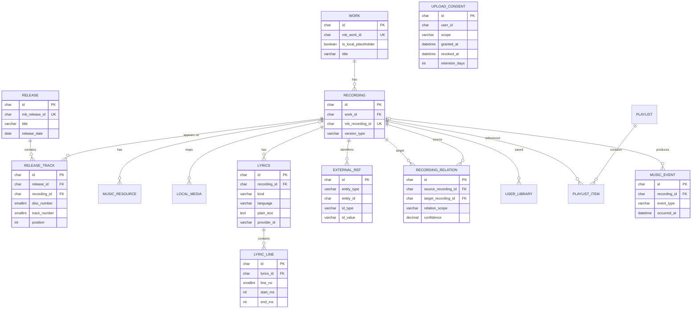

# MusicBridge 第一阶段调研报告（精简版）

- 调研核查日期：2026-11-05；第二轮修订与精简日期：2026-11-06；第三至六轮接口、部署、识曲主链路与数据库切换日期：2026-11-06
- 精简版说明：完整实测细节与原始响应已压缩，来源链接、核查日期与证据标签保留；关键数字与结论未删。
- 报告性质：单文件自包含，供评审直接阅读；不包含 Phase 0 代码，不包含新调研。

**证据标签**

| 标签 | 含义 |
| --- | --- |
| 【实测】 | 本次真实发出请求并拿到响应 |
| 【官方】 | 已读取官方文档/定价页，未发请求或已核对 |
| 【推断】 | 仅根据第三方资料或介绍推断 |
| 【未验】 | 缺密钥、账号、样本或环境，未有效验证 |
| 【待核实】 | 有审查意见但未取得官方依据 |
| 【风险】 | 法律、授权或 ToS 风险 |

**目录**

- [第 1 部分 总览与结论](#overview)
- [第 2 部分 推荐、备选、淘汰与定案程度](#recommendation)
- [第 3 部分 修订记录（第一至六轮）](#revision)
- [第 4 部分 API 全量对比与来源索引](#api)
- [第 5 部分 开源项目与维护状态](#opensource)
- [第 6 部分 成本、许可证与法律风险](#cost)
- [第 7 部分 实测记录与复现](#poc)
- [第 8 部分 Provider 架构与 ProviderManager](#provider)
- [第 9 部分 关系数据模型](#data-model)
- [第 10 部分 实施路线与最小闭环](#roadmap)
- [第 11 部分 未实测项与审查问题](#unverified)

<a id="overview"></a>
## 第 1 部分 总览与结论

### 1.1 项目与目标

MusicBridge 是“跨平台音乐资源整合与个人音乐空间”：用户从网页、视频、系统播放音频或本地文件发现音乐，统一管理歌曲信息、平台资源、歌词、翻译、本地文件、收藏、歌单和时间线。采用 SOA/模块化单体，优先复用成熟开源项目与合法 API，所有外部能力必须可替换、可限流、可降级。

本阶段只做调研、验证与架构设计，不写业务代码、不注册付费服务、不上传密钥、不调用非官方接口。项目定位为个人使用、非商业用途；下述免费/非商业授权结论均以此为前提成立。

### 1.2 一句话结论

**第一版采用 Local-first（Electron 桌面端 + 仅绑定 `127.0.0.1` 的本机 Spring Boot + 本机 MySQL 8.x），识曲以 AudD 为主选（RAW_AUDIO，需上传授权）、ACRCloud 为重点备选、Chromaprint + AcoustID 为低成本补充（AUDIO_FINGERPRINT，非商业授权）；配合 MusicBrainz/iTunes 元数据、LRCLIB 歌词、Argos 离线翻译、music-metadata 读取（标签写入待定）与文件导入/手动截取完成闭环。所有外部能力经 Provider 接口、RecognitionRouter 与 ProviderManager 进入；Mock 仅用于开发/测试/契约测试，生产降级只用真实 Provider、缓存或本地数据，密钥只放后端。**

### 1.3 五个关键发现

1. **客户端有识曲 ≠ 有公开 API**：网易云、QQ、酷狗客户端均有识曲，但公开可编程入口要么不存在，要么需商务合作；社区逆向接口不进入实现。
2. **AudD 是可直接落地的主选识别 API**：免费试用 300 次/14 天、$5/月含 1,000 次；标准接口只分析前 12 秒。流监控输入是**可访问音频流 URL**、$45/路/月，不等于桌面 WASAPI Loopback 采集。
3. **ACRCloud 是重点备选，AcoustID 是低成本补充**：ACRCloud 支持音频文件与指纹，短于 15 秒更适合、样本 <5 MB，价格/额度/资质**未核实**；AcoustID 本地算指纹、联网查询，非商业免费、3 请求/秒，覆盖率与 AudD **不等价**，不能当作默认主链路。
4. **元数据必须组合**：MusicBrainz 有 MBID/ISRC/版本关系但中文偏弱，需按 Work/Recording/Release/ReleaseTrack 四层建模；iTunes 免 Key、约 20 次/分钟，地区曲库差异明显，本次样本有限。
5. **歌词与翻译分层**：LRCLIB 同时提供普通与同步歌词，但歌词版权归原权利人；翻译用 Argos/LibreTranslate 离线完成；原文、翻译、音译三类分开存储，不能合并成一个 Provider。

### 1.4 关键风险

| 风险 | 等级 | 应对 |
| --- | --- | --- |
| 逆向接口法律/ToS | 高 | 不实现网易云/QQ/酷狗非官方接口与 SongRec |
| 歌词再发布 | 高 | 仅本地展示，导出/分享默认关闭，保留来源与举报入口 |
| 付费识别成本失控 | 中 | 本地预筛 + 缓存 + 月度预算阈值自动降级 |
| 第三方服务变更 | 中 | Provider 抽象 + 契约测试 + 健康检查 + 真实备用/缓存 |
| AGPL/GPL 义务 | 中 | 修改版 LibreTranslate 通过网络向用户提供服务时需履行源码提供义务；GPL 组件不进分发核心；独立调用边界按集成与分发评估 |
| 密钥泄露 | 中 | 密钥只在后端，日志脱敏，桌面端不直连第三方 |
| 曲库覆盖不足 | 中 | 多 Provider + 用户手动编辑 + 置信度展示 |
| 指纹外发隐私 | 中 | 授权说明覆盖原始音频与指纹；AcoustID 查询同样向第三方发送指纹 |

### 1.5 调研范围、方法与口径

- 【实测】：LRCLIB、MusicBrainz、iTunes、AudD（test token）、ListenBrainz 统计，2026-11-05 单次或少量请求。
- 【官方】：AudD 定价/流监控、AcoustID/Chromaprint、MusicBrainz 限流与许可、Spotify 变更、腾讯云计费、DeepL、ListenBrainz/Last.fm 写入、开源项目 License。
- 【未验】：AcoustID（缺 key）、ACRCloud（未开通，价格/额度/资质未核实）、腾讯云/酷狗/QQ/网易云（企业/商务）、Spotify（OAuth+Premium）、系统采集（未搭桌面程序）。
- 口径：单点样本不推导总体覆盖；限流以官方原文为准，客户端更保守；成本按官方单价线性推算，不含税费/汇率/重试放大。

### 1.6 部署拓扑（Local-first，未来可迁远程）

| 层 | 第一版（本机） | 未来（远程可选） | 契约是否变化 |
| --- | --- | --- | --- |
| 桌面端 | Electron + React + TS：扫描、索引、截取、交互 | 同一客户端 | 否 |
| 后端 | Spring Boot，仅绑定 `127.0.0.1` | 远程 Spring Boot | 否，只换 base URL |
| 数据库 | 本机 MySQL 8.x（InnoDB、`utf8mb4`） | 远程 MySQL 8.x | 否，换连接与迁移配置 |
| 本地文件 | 留在用户电脑，由桌面端管理 | 仍由桌面端管理，远程只收必要片段/元数据 | 否 |

四条边界：

1. 本地文件路径与扫描索引由桌面端管理，不进入远程业务库；远程只存归属与索引摘要，不存绝对路径。
2. 统一 REST API：客户端只替换 base URL，不分叉第二套接口。
3. Provider 密钥只放服务端配置，不硬编码进 Electron；桌面端不直连第三方。
4. 从第一版保留 `user_id`、数据归属与本地会话令牌，不假设“只有本机一个用户”，迁移无需补造身份。

<a id="recommendation"></a>
## 第 2 部分 推荐、备选、淘汰与定案程度

### 2.1 推荐 / 备选 / 淘汰

| 能力 | 推荐（第一版） | 备选 | 淘汰 |
| --- | --- | --- | --- |
| 识别 | AudD 标准接口（主选，RAW_AUDIO，前 12 秒，$5/1,000 次） | ACRCloud（重点备选，RAW_AUDIO / AUDIO_FINGERPRINT）；Chromaprint + AcoustID（低成本补充，非商业）；腾讯云/酷狗（商务） | 网易云/QQ 逆向、SongRec |
| 元数据 | MusicBrainz（主）+ iTunes（补封面/地区） | Cover Art Archive | Spotify 作为主源 |
| 歌词 | LRCLIB + 本地 LRC | LRCGET（工具参考） | Musixmatch/Genius 未授权抓取、网易云非官方接口 |
| 翻译 | Argos Translate（离线） | LibreTranslate（自托管 AGPL）；DeepL Free | 未授权翻译接口 |
| 音译 | pypinyin + kuroshiro | 自研规则表 | 与翻译混为同一能力 |
| 本地管理 | music-metadata（读）+ Chromaprint；写标签**待定** | TagLib、music-metadata-editor、node-taglib-sharp | 假设 music-metadata 可写；提前锁定单一库 |
| 桌面采集（Phase 4） | electron-audio-loopback（PoC 候选） | NAudio 独立进程；ApplicationLoopback | Rust 采集进入第一版；第一版依赖系统采集 |
| 时间线 | 自建 `MusicEvent` + ListenBrainz 可选 | Last.fm 同步 | 依赖外部平台承载完整时间线 |

### 2.2 定案程度

| 能力 | 推荐 | 定案程度 |
| --- | --- | --- |
| 短片段识别 | AudD 标准接口（主选） | 已确定（成本待验证） |
| 商业备选识别 | ACRCloud（RAW_AUDIO + AUDIO_FINGERPRINT） | **待实测**（价格/额度/资质未核实，需与 AudD 同样本对照） |
| 本地指纹识别 | Chromaprint + AcoustID | 低成本补充（个人非商业、3 req/s）；转商业须替换 |
| 连续音频识别 | 本地采集 + 指纹；流监控仅商务选项 | 待实测 |
| 元数据主源 | MusicBrainz | 已确定（四层实体 + 1 req/s） |
| 元数据补充 | iTunes Search | 待测试（需扩大抽样） |
| 歌词 | LRCLIB + 本地 LRC | 已确定（官方近似值非合同） |
| 翻译 | Argos 离线 | 待测试（质量未评测） |
| 音译 | pypinyin + kuroshiro | 待测试 |
| 本地标签写入 | 未定 | **待定** |
| 桌面采集 | electron-audio-loopback / NAudio | **待实测（Phase 4；均未真机验证）** |
| 时间线 | 自建 + ListenBrainz 可选 | 已确定（同步待授权验证） |

### 2.3 推荐组合的边界

推荐组合只覆盖短片段识别、元数据补全、歌词获取、离线翻译与本地管理；识曲由 RecognitionRouter 在 `inputType`、能力、授权与成本之间选路，AudD 主选、ACRCloud 重点备选、AcoustID 低成本补充，不承诺完全离线识别、高频连续识别、商业歌词再分发与跨平台采集一致性，边界见 4.8。

<a id="revision"></a>
## 第 3 部分 修订记录

第一轮 16 项与第二轮 4 项 + 采集定案合并如下；“改前→改后”只保留结论性差异，依据保留官方来源。

| # | 项目 | 改前 → 改后 | 依据 |
| --- | --- | --- | --- |
| 1 | AcoustID 定性 | “离线识别/ AudD 替代” → 本地只算指纹，仍需联网查询；覆盖率不等价，仅低成本备选 | AcoustID Web Service、Chromaprint 仓库 |
| 2 | 流监控 vs 桌面采集 | 混为一谈 → 流监控输入是流 URL、$45/路/月；桌面采集是本地声卡回环 | AudD Streams 文档 |
| 3 | 识别成本 | 86,400 次写 $450 → 按量 $432，并给 600/4,500/86,400 三档 | AudD 定价页 |
| 4 | LRCLIB 限流 | 45/90 当硬限制 → ~45/~90/~180 为非合同近似值；客户端另设安全阈值，以 `Retry-After` 为准 | [LRCLIB 文档](https://lrclib.net/docs)，抓取 2026-11-05 |
| 5 | Spotify | 只写 5 用户 → 补 2026-02 端点收缩；2026-07 配额**待核实** | Spotify changelog |
| 6 | iTunes 结论 | “中国区普遍 0” → 单点观察，样本有限；给复测矩阵 | 本次实测 |
| 7 | MusicBrainz 概念 | Release 当歌曲 → Work/Recording/Release/ReleaseTrack 四层 | MusicBrainz Entity 文档 |
| 8 | Mock 定位 | 生产兜底 → 仅开发/测试/契约测试 | 架构评审 |
| 9 | 识别输入 | 仅 RAW_AUDIO → RAW_AUDIO / AUDIO_FINGERPRINT 双模式 + 能力声明 | 评审要求 |
| 10 | 失败语义 | 任何错误都切换 → 8 类错误码分类处理 | 评审要求 |
| 11 | 共享限流/缓存 | 单实例 sleep → 多实例共享限流、查询缓存、single-flight、退避、可识别 UA | 评审要求 |
| 12 | MusicBrainz 许可 | 笼统 CC0 → Core CC0；Supplementary CC BY-NC-SA 3.0；保留来源四件套 | MusicBrainz Data License |
| 13 | 关系模型 | 单一 relationType + 阈值隐藏 → 录音关系收敛为“同作品不同录音”一类 + 用户确认，取消硬阈值；同录音多发行改由 Release/ReleaseTrack 表达 | 评审要求 |
| 14 | 歌词存储 | 原文/翻译混存 → ORIGINAL/TRANSLATION/TRANSLITERATION 分存 | 评审要求 |
| 15 | 标签写入 | 锁定 node-taglib-sharp → 降级为待定，对比后再选 | npm 元数据 |
| 16 | 腾讯云计费 | “每 10 秒算 1 分钟” → 3 元/分钟，累计秒数换算分钟并**向上取整** | 腾讯云 MPS 文档 |
| 17 | LRCLIB 证据 | 只写近似数字 → 补官方原文、抓取日期 2026-11-05、三类数字（官方近似/实测/客户端阈值） | LRCLIB `/docs` |
| 18 | Track/Recording 命名 | 后端 `track` 表 → `recording` 表；`release_track.recording_id`；DTO 统一 Work/Recording/Release/ReleaseTrack；Track 仅界面概念或 deprecated 别名 | 评审要求 |
| 19 | 缓存与降级 | 只有 24h/7d → TTL 矩阵、来源四件套、字段级冲突合并、用户数据不可覆盖、负缓存、stale 标记 | 评审要求 |
| 20 | 403/429 规则 | 403 一律可切、429 只读头 → 功能级/账号级区分；切换上限 1–2 次 + 熔断；有条件切换并提示 | 评审要求 |
| 21 | 桌面采集定案 | “MVP/稳定版”像已定 → 明确两者均未真机验证；给出 PoC 门槛后才定案 | 本阶段未搭建桌面程序 |

**第三轮修订（5 项优先 + 7 项细节 + 费用口径）**

| # | 项目 | 改法 | 依据 |
| --- | --- | --- | --- |
| 1 | 录音关系收敛 | 删除 `SAME_RECORDING_DIFFERENT_RELEASE`；同录音多发行只通过多个 `release_track → release` 查询表达，不单独存关系边 | 第三轮评审 |
| 2 | 上传授权 | 删除客户端布尔值；新增 `UploadConsent`；请求只传 `consentId`，后端上传前校验，撤销后停止上传并按保留策略清理 | 隐私与合规 |
| 3 | 候选脱敏 | 删除 `RecognitionCandidate.raw`；只留规范字段 + `debugReference`，原始响应不进业务层/持久化/普通日志 | 数据最小化 |
| 4 | 指纹识别链路 | 明确 AcoustID 只做指纹匹配并返回 MB Recording ID，再由 MusicBrainz 查实体；MusicBrainz 不接受指纹查询 | 官方接口边界 |
| 5 | 采集阶段 | Phase 1 用文件导入/手动截取完成闭环；Phase 4 才做系统采集 PoC，失败则保留文件导入 | 降低首版风险 |
| 6 | 健康检查与请求校验 | `health()` 拆静态配置检查与主动探测（默认关闭、白名单、缓存）；`RecognitionRequest` 按 `inputType` 校验，不匹配 400 | 避免计费与脏请求 |
| 7 | clips/recognitions 分工 | clips 只存片段返回 `clipId`；recognitions 只识别并引用 `clipId`/指纹；补调用时序 | 接口单一职责 |
| 8 | 字段级许可 | 新增 `field_provenance`，同一记录按字段记录 CC0 / CC BY-NC-SA 3.0 与来源 | MusicBrainz 双许可 |
| 9 | 本地文件与外部标识 | `LocalMedia` 改 `UNIQUE(user_id, path)`、`file_hash` 普通索引；ISRC/MBID/Spotify ID 走 `external_ref`；`music_event.recording_id` 可空 | 多副本与多标识现实 |
| 10 | 费用口径 | 600 次常规成本 $5；仅试用期内且未超 300 次为 $0；不再写 `$0–$5` 区间 | AudD 定价页 |

**第四轮修订（5 项 + 4 细节）**

| # | 项目 | 改法 | 依据 |
| --- | --- | --- | --- |
| 1 | 歌词模型 | 普通/同步共用一条 `Lyrics`（`plain_text` + `LyricLine`），不设 `format`，唯一约束不变 | 第四轮评审 |
| 2 | clips 输入与隔离 | 第一版仅 `multipart`，不接受客户端路径；`clipId`/`consentId` 校验归属，跨用户 404/403 | 第四轮评审 |
| 3 | AcoustID 定位 | 曾设为个人非商业默认链；第五轮改为 AudD 主选、AcoustID 仅低成本补充 | 项目定位为非商业 |
| 4 | AGPL 表述 | 仅修改版对外服务需履行源码义务；独立调用按程序边界/集成/分发评估 | AGPL 条款 |
| 5 | Work 与 Recording | 无外部 Work 时建占位 Work（`is_local_placeholder`），`work_id` 改 NOT NULL；补合并规则 | 第四轮评审 |
| 6 | 发行日期 | 删除 `recording.release_date`；`first_release_date` 由 Release 聚合派生 | 第四轮评审 |
| 7 | 非阻塞细节 | 限流器单/多实例方案；`external_ref` 应用层一致性校验；SQL 标注核心示例 | 第四轮评审 |

> 2026-11-06 完成第四轮接口与模型收口；不重新调研、不改 API 选型/价格/许可证结论、不开始 Phase 0、不初始化 git。

**第五轮修订（A 部署 + B 识曲主链路 + C P0/P1/P2）**

| # | 项目 | 改法 | 位置 |
| --- | --- | --- | --- |
| 1 | 部署与本地归属 | Local-first（Electron + 127.0.0.1 Spring Boot + 本机 PostgreSQL）；`local_media.file_path` 为桌面端索引，`recording_id` 可空；`/local/scan` 由桌面端执行 | 1.6、8.1、9.3、9.4 |
| 2 | 占位 Work | `source_provider` 允许 `LOCAL`，不强制外部 record id | 9.3、9.4 |
| 3 | 识曲主链路 | AudD 主选、ACRCloud 重点备选、AcoustID 低成本补充；不再设默认链 | 1.2、1.3、2.1、4.1、8.2、10.3 |
| 4 | RecognitionRouter 与切换 | 按输入/能力/授权/成本路由；跨 Provider 仅同输入且能力匹配；仅兼容 Provider 可改 enabled/priority | 8.2、8.7、8.10 |
| 5 | ACRCloud 调研 | 识别/指纹接口、<15 秒、<5 MB、认证、SDK；价格/额度/资质未核实 | 4.1.1、4.9、8.8 |
| 6 | 隐私 | 指纹外发同样需提示 | 1.4、8.3、8.9 |
| 7 | clips 与授权 | 产品 10 秒 / 接收 12 秒、5 MB、16–48 kHz / Provider 限制；指纹免 consent；撤销后停传、取消任务、清临时文件 | 8.2、8.3 |
| 8 | 歌词约束 | `language` 必填；`plain_text` 或 `LyricLine` 至少一项；时间非负有序 | 9.3、9.4 |
| 9 | 录音关系 | 禁止自指、反向边规范序唯一、subtype CHECK | 9.3、9.4、9.5 |
| 10 | 候选与事件 | `candidateReleaseHint` 非权威；补 RECOGNIZED/CONFIRMED/ADDED_TO_LIBRARY 时点 | 8.2、9.3、10.3 |
| 11 | 调用预算 | 单任务重试+切换+429 合计上限，超时不重复计费 | 8.5、8.10 |
| 12 | Phase 口径 | Phase 1 最小桌面客户端；Phase 0 无客户端；管理仅 API；标签只读 | 10.1、10.2 |
| 13 | P2 与前置 | 成本公式；ER 为示意；Playlist/Track 迁移列后续；`recognize()` 拆分；歌词缓存与字段许可映射 | 6.1、8.6、9.6、9.7、10.3、10.6 |

> 本轮不重新调研、不改已通过的选型/价格/许可证结论、不写 Phase 0 代码、不新增文件。

**第六轮修订（数据库改为 MySQL 8.x）**

| # | 项目 | 改法 | 位置 |
| --- | --- | --- | --- |
| 1 | 数据库选型 | 本机/远程 PostgreSQL → MySQL 8.x（InnoDB、`utf8mb4`）；部署拓扑、技术栈与 Flyway 表述同步 | 1.2、1.6、6.4、8.1、10.2、10.4 |
| 2 | UUID 表示 | 统一 `CHAR(36)` + `ascii_bin`，不采用 `BINARY(16)` | 9.3、9.4、9.6 |
| 3 | 时间与 JSON | `TIMESTAMPTZ` → `DATETIME(3)`；`JSONB` → `JSON`；`now()` → `CURRENT_TIMESTAMP(3)` | 9.3、9.4 |
| 4 | DDL 适配 | 表级外键、`release` 反引号、生成列实现关系规范序唯一、标识列大小写敏感排序规则、`TEXT` 改 `VARCHAR` | 9.4 |
| 5 | 迁移注意点 | CHECK 8.0.16+、唯一约束 NULL、无部分索引、排序规则、`FULLTEXT` 与 `LIKE` 差异 | 9.8 |
| 6 | 应用层兜底 | 跨表歌词条件、`external_ref` 一致性、唯一冲突人工确认等 SQL 无法保证的约束 | 9.3、9.8 |

> 2026-11-06 完成第六轮数据库切换；不重新调研、不改 Provider 与数据模型结论、不写 Phase 0 代码、不新增文件；文档不记录任何真实数据库口令。第五轮表中的“本机 PostgreSQL”为历史记录，已在第六轮改为 MySQL 8.x。

<a id="api"></a>
## 第 4 部分 API 全量对比与来源索引

### 4.1 音乐识别

| 服务 | 官方性 | 输入 | 免费额度 | 付费 | Key | 证据 |
| --- | --- | --- | --- | --- | --- | --- |
| **AudD** | 官方商业 API | 文件 URL/上传，标准接口仅前 12 秒；流监控需可访问流 URL | 300 次/14 天；test token 10 次/天 | $5/月含 1,000 次，超出 $5/1,000；流监控 $45/路/月；企业按每 12 秒计费 | 必需 | 【实测】识别成功；【官方】定价 |
| **AcoustID + Chromaprint** | 官方开源服务 | 本地算指纹 + 联网查询 | 非商业免费，3 请求/秒 | 商业需 acoustid.biz 签约 | client key | 【官方】；【未验】无 key |
| **ACRCloud** | 官方商业 API | 音频文件或已提取指纹；短于 15 秒更适合，样本 <5 MB | **未核实**（未取得官方额度原文） | **未核实**（不得引用未验证价格） | access key/secret + host + HMAC 签名 | 【官方】接口/限制；【未验】未开通、未实测 |
| **腾讯云音乐识别** | 官方云服务 | 视频/音频任务 | 未说明 | **3 元/分钟**，累计秒数向上取整 | 腾讯云签名 | 【官方】；【未验】 |
| **网易云识曲** | 客户端功能，无公开 API | 客户端录音/上传 | — | — | 非公开 | 【风险】【推断】 |
| **QQ 音乐识曲** | 客户端/商务 | — | — | 商务报价 | 商务 | 【风险】【未验】 |
| **酷狗听歌识曲** | 官方开放平台 | SDK/接口 | 无公开额度 | 商务报价 | `pid/pkey` | 【官方】；【未验】 |
| **SongRec** | 非官方（逆向 Shazam） | 本地录音→Shazam | 无授权 | 无 | 无 | 【风险】GPL-3.0 |
| **Mock** | 自建 | 固定样本 | — | — | — | 仅开发/测试/契约测试 |

结论：AudD 为第一版主选（RAW_AUDIO，需上传授权）；ACRCloud 为重点备选（需同样本对照）；Chromaprint + AcoustID 为低成本补充（FINGERPRINT，仅个人非商业，3 次/秒）；腾讯云/酷狗为商务备选（腾讯云按分钟计费不适合高频）；网易云/QQ 逆向与 SongRec 淘汰；Mock 不进生产。

补充要点：

- AudD 标准接口只取前 12 秒，适合“用户主动识别一次”，不适合连续监听；连续监听需走企业端点（每 12 秒计费）或流监控（$45/路/月）。
- 免费试用 300 次/14 天与 test token 10 次/天都只适合联调，不能作为容量规划依据。
- 上传音频涉及用户授权与隐私：桌面端展示授权说明并取得 `UploadConsent` 后，识别请求只传 `consentId`；后端在上传前校验授权状态，撤销即停止上传（见 8.2）。指纹查询同样外发第三方，授权与隐私提示必须覆盖指纹。

#### 4.1.1 ACRCloud 调研（重点备选）

| 项 | 结论 | 证据 |
| --- | --- | --- |
| 官方接口 | 音频文件识别 + 指纹识别接口；指纹可由 SDK 本地提取后上传 | 【官方】 |
| 输入限制 | 建议短于 15 秒的样本；单个样本 <5 MB | 【官方】 |
| 认证 | `access_key` + `access_secret` + `host`，HMAC 签名；密钥只放服务端 | 【官方】 |
| SDK | 官方提供 Java/Node.js/Python SDK；本项目仅服务端用 Java SDK 或 REST | 【官方】 |
| 计费/免费额度 | **未取得官方额度原文，不作数字结论**；是否需企业资质同样【未验】 | 【未验】 |
| 实测 | 未开通、未上传样本；准确率与中文覆盖**未实测** | 【未验】 |

待测：用同一批中文/英文/翻唱/现场样本与 AudD 对照命中率、Top1、延迟与单位成本；确认账号类型、免费额度与企业资质。对照前 ACRCloud 只作重点备选。

### 4.2 音乐元数据

| 服务 | 能力 | 认证/限制 | 免费/付费 | 覆盖特点 | 证据 |
| --- | --- | --- | --- | --- | --- |
| **MusicBrainz** | Work/Recording/Release/ReleaseTrack + MBID/ISRC/关系 | 免认证，需可识别 UA；1 req/s/IP，超限 503 | 免费；Core CC0，Supplementary CC BY-NC-SA 3.0 | 版本关系最完整，中文偏弱 | 【实测】`count=233`；【官方】限流/许可 |
| **iTunes Search** | 搜索、封面、地区曲库 | 无需 Key；约 20 次/分 | 免费 | 地区差异；无 Work/Recording 分层 | 【实测】英文/繁体可查；`country=cn` 单点 0（样本有限） |
| **Spotify Web API** | 搜索/ID/封面 | OAuth；开发模式需 Premium | 受配额 | 欧美强、中国弱；2026-02 端点收缩 | 【官方】；2026-07 配额（含 25 个 Client ID 共享配额的传言）【待核实】 |
| **Cover Art Archive** | 封面 | 跟随 MusicBrainz | 免费 | 图片版权需核对 | 【官方】 |

MusicBrainz 必须按四层建模：Work（作品）/ Recording（录音版本）/ Release（发行载体）/ ReleaseTrack（录音在某次发行中的位置）。翻唱/Live/Remix 在 Recording 层区分；同一 Recording 多次发行走 Release/ReleaseTrack。

中文覆盖：MusicBrainz 建 MBID 骨架，iTunes 只补封面/地区/别名，不用 `trackId` 当主键；冲突保留双方并记录来源。中文曲目缺 MBID 时允许“本地实体 + 外部引用”入库。

**指纹识别链路（AcoustID → MusicBrainz）**：本地音频 → Chromaprint → AcoustID Lookup（返回匹配与 MB Recording ID）→ MusicBrainz API 查 Work/Recording/Release/ReleaseTrack → 组装候选。AcoustID 只做指纹匹配，不提供完整元数据；MusicBrainz 不接受指纹查询，二者必须串联。

### 4.3 歌词

| 服务 | 同步歌词 | 限制 | 授权 | 证据 |
| --- | --- | --- | --- | --- |
| **LRCLIB** | 普通 + LRC，搜索最多 20 条无分页 | 官方近似 ~45/~90/~180 次/分/IP（非合同）；429 + `Retry-After` | 数据库免费，歌词版权归原权利人 | 【实测】20 条含同步歌词；【官方】字段/限流 |
| **本地 LRC** | 有 | 无 | 用户自有 | 离线兜底 |
| **Musixmatch/Genius** | 有 | 商业授权/条款限制 | 需单独合规评审 | 【风险】 |

#### LRCLIB 限流证据（2026-11-05 抓取）

来源：[https://lrclib.net/docs](https://lrclib.net/docs)。官方未标注版本号。关键原文：

> “The exact limits are **not part of the API contract**: the figures below are approximations of the current settings and may change at any time without notice.”

> “Generic client: `~45 requests/min per IP`；Identified client: `~90 requests/min per IP`；Registered client-side application: `~180 requests/min per IP`，另有 app-wide `~6,000 requests/min`。”

> “Your client **must** honor `Retry-After`… add a small random jitter (for example, up to 30% of the delay)…”

> “send requests sequentially… add a short delay between requests (**200–500 ms**)…”

| 数字类型 | 取值 | 性质 |
| --- | --- | --- |
| 官方近似值 | ~45 / ~90 / ~180 次/分/IP；app-wide ~6,000/分 | 非合同、可随时变化 |
| 本次实测观察值 | 1 次 `GET /api/search`，HTTP 200、20 条、未触发 429 | 单次请求，不能推导速率 |
| 客户端安全阈值（自定） | 约 20–30 次/分，串行，批量 200–500ms，429 按 `Retry-After` | 项目保护值，非官方配额 |

官方要求：可识别 `User-Agent`、串行请求、批量 200–500ms、429 遵守 `Retry-After`、无需 API Key；实现以 `Retry-After` 为准。**不能把 45/90/180 写成硬性配额。**

本地 LRC 与在线歌词的优先级：用户导入或手写的本地 LRC 视为用户数据，展示优先级最高且不被自动刷新覆盖；在线歌词仅在缺失或用户主动刷新时写入，二者来源、语言与 `kind` 分开记录。

### 4.4 翻译与音译

| 方案 | 类型 | 免费额度 | 成本 | 许可 | 证据 |
| --- | --- | --- | --- | --- | --- |
| Argos Translate | 开源离线 | 无限制 | 0 | MIT | 【官方】 |
| LibreTranslate | 自托管 | 自托管免费 | 服务器成本 | **AGPL-3.0** | 【官方】 |
| DeepL API Free | 商业 | 500,000 字符/月 | 超出转 Pro | 商业条款 | 【官方】 |
| pypinyin / kuroshiro | 音译库 | 免费 | 0 | MIT | 【官方】 |

翻译 ≠ 音译：翻译改语义，音译只转写读音；独立 Provider、独立字段、独立存储。

AGPL 边界：对 LibreTranslate 的修改版本通过网络向用户提供服务时，需履行 AGPL 源代码提供义务；独立调用方是否受影响，应结合程序边界、集成方式与分发方式评估，不能直接推断整个 MusicBridge 必须开源。

### 4.5 本地音乐管理

| 库 | 读/写 | 许可 | 状态 |
| --- | --- | --- | --- |
| music-metadata | 只读 | MIT | 首选读取 |
| music-metadata-editor | 读写 | MIT | 写标签候选（0.2.0，未定案） |
| TagLib / node-taglib-sharp | 读写 | LGPL-2.1 | 写标签候选（需处理原生依赖） |
| Chromaprint | 指纹 | LGPL（需复核） | 指纹/去重 |

**写标签方案待定**，Phase 2 前用真实文件对比格式覆盖、写入回读一致性与 Electron 打包成本。

### 4.6 桌面音频采集

| 方案 | 集成 | 能力 | 状态 |
| --- | --- | --- | --- |
| NAudio + WASAPI Loopback | C#/.NET 独立进程 | 系统混音回环 | **未真机验证** |
| electron-audio-loopback | Electron 插件 | `desktopCapturer` 回环 | **未真机验证**，MVP 候选 |
| Microsoft ApplicationLoopback | C++/Win32 | 按进程采集 | 官方示例，备选 |
| Rust/WASAPI 直调 | Rust/C++ | 控制力最强 | 第一版不进入 |

两者均未真机验证：Electron 只是 MVP 候选，不是已验证选型；NAudio 的静音检测、重采样、设备切换也未实测。**PoC 通过门槛**：连续采集 ≥30 分钟（另跑 2 小时漂移）、44.1/48kHz 16-bit 单/立体声无爆音、丢帧率 <0.5%（2 小时 <3.6 秒）、Electron 集成方式明确且 IPC 不阻塞 UI、空闲 CPU <5%/录音 <15%、权限与设备切换可恢复。全部满足才定案。

采集还需覆盖的实际问题：设备切换（耳机/蓝牙/默认设备变化）后能自动重建回环；系统静音或无声时不能把静音段当识别请求；采样率不一致时统一重采样到 44.1kHz 或 48kHz 单声道再算指纹；权限被拒或设备被独占时要给出明确提示，而不是静默失败。

**阶段定位**：第一版识别闭环不依赖系统音频采集，先用文件导入/手动截取约 10 秒片段；系统音频自动采集整体后移到 Phase 4，按上述门槛做 PoC，通过才进入正式版本，失败则保留文件导入与手动识别，不阻塞项目。

### 4.7 音乐时间线

| 方案 | 可写事件 | 认证 | 限制 |
| --- | --- | --- | --- |
| ListenBrainz | playing_now/单曲/喜欢 | 用户 token | 响应头限流；写入需授权 |
| Last.fm | scrobble/now playing/love | API Key + 会话 | 批量 50；错误码 29 |
| 自建 `MusicEvent` | 发现/识别/入库/播放/收藏/歌单 | 本地用户 | 无外部限制 |

“网页发现→识别→入库”的完整时间线必须自建，ListenBrainz 只作可选同步出口。

### 4.8 能力边界：四档可替代性

- **等价替代**：输入/输出语义基本一致，切换只影响质量与成本。
- **部分替代**：只覆盖部分场景，或字段/精度不同，需要业务补偿。
- **仅补充**：不能承担主路径，只提供额外信息或低成本预筛。
- **不可互换**：输入来源、计费口径、授权不同，强行替换会出错或违规。

**明确不可互换的组合**：

1. **AudD ↔ AcoustID**：上传音频查商业曲库 vs 本地指纹查众包库；覆盖、中文曲目、置信度、授权都不同。AcoustID 只能作低成本补充。
2. **AudD 流监控 ↔ WASAPI Loopback**：前者输入可访问流 URL、按 $45/路/月；后者输入本机系统播放音频、无外部计费。两套链路。
3. **Spotify ↔ MusicBrainz/iTunes**：Spotify 配额门槛高、2026-02 端点收缩、无 Work/Recording 分层，不能当主源。
4. **翻译 ↔ 音译**：语义转换 vs 读音转写，必须两个服务、两个字段。
5. **Mock ↔ 任何真实 Provider**：无真实曲库与置信度，生产返回即假数据。
6. **AudD ↔ ACRCloud**：同为 RAW_AUDIO 商业识别，但曲库覆盖、计费口径与中文准确率未对照，只能“部分替代/待测”，不能默认互换。

### 4.9 来源索引

| 主题 | 链接 |
| --- | --- |
| AudD | https://docs.audd.io/ ｜ https://audd.io/pricing |
| AcoustID / Chromaprint | https://acoustid.org/webservice ｜ https://github.com/acoustid/chromaprint |
| ACRCloud（官方文档/定价） | https://docs.acrcloud.com/ ｜ https://www.acrcloud.com/pricing/ |
| MusicBrainz API / 限流 / 许可 | https://musicbrainz.org/doc/MusicBrainz_API ｜ https://musicbrainz.org/doc/MusicBrainz_API/Rate_Limiting ｜ https://musicbrainz.org/doc/About/Data_License |
| MusicBrainz 实体 | https://musicbrainz.org/doc/MusicBrainz_Entity |
| iTunes Search | https://performance-partners.apple.com/search-api |
| Spotify 配额 / 2026-02 变更 | https://developer.spotify.com/documentation/web-api/concepts/quota-modes ｜ https://developer.spotify.com/documentation/web-api/references/changes/february-2026 |
| LRCLIB | https://lrclib.net/docs |
| Argos / LibreTranslate | https://github.com/argosopentech/argos-translate ｜ https://github.com/LibreTranslate/LibreTranslate |
| DeepL 用量 | https://support.deepl.com/hc/en-us/articles/360020685720-Usage-count-and-billing-in-DeepL-API |
| music-metadata / editor / TagLib | https://github.com/Borewit/music-metadata ｜ https://www.npmjs.com/package/music-metadata-editor ｜ https://taglib.org/ |
| NAudio / WASAPI / ApplicationLoopback | https://github.com/naudio/NAudio ｜ https://learn.microsoft.com/windows/win32/coreaudio/loopback-recording ｜ https://learn.microsoft.com/samples/microsoft/windows-classic-samples/applicationloopbackaudio-sample/ |
| ListenBrainz / Last.fm | https://listenbrainz.readthedocs.io/en/latest/users/api/ ｜ https://www.last.fm/api |
| 腾讯云音乐识别 / MPS 定价 | https://cloud.tencent.com/document/product/862/124564 ｜ https://buy.cloud.tencent.com/price/mps/overview |
| 酷狗开放平台 | https://open.kugou.com/ |
| LRCGET | https://github.com/tranxuanthang/lrcget |

<a id="opensource"></a>
## 第 5 部分 开源项目与维护状态

| 项目 | 许可证 | 维护状态 | 用途/结论 |
| --- | --- | --- | --- |
| LRCGET | MIT | 活跃 | 歌词工具参考 |
| LRCLIB | 服务免费 | 活跃 | 歌词主源，版权受限 |
| Argos Translate | MIT | Release 停留在 2021，仍有提交 | 离线翻译 PoC |
| LibreTranslate | AGPL-3.0 | 活跃 | 自托管备选；修改版对外服务需履行源码义务 |
| music-metadata | MIT | 活跃 | 只读解析 |
| music-metadata-editor | MIT | 0.2.0（2026-11） | 写标签候选，未定案 |
| TagLib / node-taglib-sharp | LGPL-2.1 | 活跃 | 写标签候选 |
| NAudio | MIT | 活跃 | 采集候选，未真机验证 |
| electron-audio-loopback | MIT | v1.0.6（2025-08） | MVP 采集候选，未真机验证 |
| ListenBrainz Server | GPL-2.0 | 活跃 | 可选同步，不必自部署 |
| NeteaseCloudMusicApi | **无 License** | 已归档 | **淘汰** |
| QQMusicApi | GPL-3.0 | 停更 | **淘汰** |
| SongRec | GPL-3.0 | 逆向 Shazam | **淘汰** |

维护风险：归档/停更项目不进代码路径；无 License 组件不可分发；修改版 AGPL 程序通过网络提供服务需提供源码；GPL 衍生分发需谨慎；Argos 发布停滞需自行验证兼容性；“客户端有功能”不等于有公开 API。

- 归档或无 License 项目（NeteaseCloudMusicApi、QQMusicApi、SongRec）只作反面参考，不进入依赖清单。
- AGPL（LibreTranslate）与 GPL（ListenBrainz Server）仅在自托管/内部使用；若要对外提供网络服务，需评估开源义务。
- LGPL（TagLib、Chromaprint）需保持动态链接与可替换性，打包方式在 Phase 2 前验证。
- 维护状态按最近提交与发布判断；Argos 发布停滞，升级前需自行验证模型与运行时兼容性。

<a id="cost"></a>
## 第 6 部分 成本、许可证与法律风险

### 6.1 识别成本

AudD 官方价格：Free trial $0/300 次（14 天）；Indie $5/月含 1,000 次、超出 $5/1,000；Startup $450/月/100,000 次；Pro $850/月/200,000 次；流监控 $45/路/月；Enterprise 按每 12 秒音频 1 次计费。

计算口径：`总成本 = 5 + max(0, N − 1,000) / 1,000 × 5`。

| 场景 | 月请求量 | 计算 | 月成本 |
| --- | --- | --- | --- |
| 课程演示 | 600 | 按 Indie 套餐 $5/月含 1,000 次 | **$5**（仅试用期内且未超 300 次时为 $0） |
| 个人自用 | 4,500 | `5 + max(0, 4,500−1,000)/1,000×5 = 22.5` | **$22.5** |
| 连续监听（按 30 天、每天 8 小时、10 秒一次估算） | 86,400 | `5 + max(0, 86,400−1,000)/1,000×5 = 432` | **$432** |
| 对照 Startup | 86,400 | 固定 100,000 次包 | $450（更贵） |
| 改用流监控 | 1 路 | 按路固定 | **$45** |

**三档核心数字：600 = $5（仅免费试用额度内为 $0）；4,500 = $22.5；86,400 = $432。** 流监控输入必须可访问音频流 URL，不是桌面采集。

### 6.2 腾讯云

3.0 元/分钟，按源视频时长；计费周期内累计秒数换算分钟并**向上取整**，不是每段 10 秒各算 1 分钟。1 小时 180 元，8 小时/天 1,440 元/天；不适合高频实时。

### 6.3 其他成本

| 项 | 费用 | 限制 |
| --- | --- | --- |
| MusicBrainz | 免费 | 1 req/s/IP，需 UA，无 SLA |
| iTunes | 免费 | 约 20 次/分，地区差异 |
| LRCLIB | 免费 | 官方近似限流非合同，429 按 `Retry-After` |
| Argos | 0 | 本地算力 |
| DeepL Free | 500,000 字符/月 | 约 250 首/月（按 2,000 字符/首） |

### 6.4 许可证与数据授权

| 组件/数据 | 许可 | 商业分发注意 |
| --- | --- | --- |
| Electron/React/TS/Spring Boot/MySQL 8.x | MIT/Apache-2.0/GPL-2.0（FOSS 例外） | 前端与 Spring Boot 自由使用；MySQL Community 版个人非商业自用免费，随产品分发或对外服务需评估 GPL 义务 |
| music-metadata / music-metadata-editor | MIT | 自由使用 |
| TagLib / node-taglib-sharp | LGPL-2.1 | 动态链接/隔离分发需评估 |
| NAudio / electron-audio-loopback | MIT | 自由使用 |
| Argos | MIT | 模型可能单独许可 |
| LibreTranslate | **AGPL-3.0** | 修改版通过网络向用户提供服务时需提供源码；独立调用是否受影响按程序边界/集成/分发评估 |
| ListenBrainz Server | GPL-2.0 | 衍生分发需开源 |
| MusicBrainz 数据 | **Core CC0；Supplementary CC BY-NC-SA 3.0** | 必须区分两类；Supplementary 不得商用且需相同方式共享 |
| iTunes 内容/封面 | Apple 条款/唱片公司版权 | 不得批量抓取或再分发 |
| LRCLIB 歌词 | 数据库免费，歌词版权归原权利人 | **高**；再发布需谨慎 |

所有外部数据统一保留 `source_provider`、`source_record_id`、`source_license`、`retrieved_at`；许可按字段记录在 `field_provenance`，不得把整条记录笼统标成单一许可。

### 6.5 法律风险与成本控制

风险：逆向接口不实现；客户端识曲≠公开 API；歌词默认仅本地展示、导出默认关闭；封面仅缓存必要项并注明来源；AGPL/GPL/LGPL 义务分别标注；密钥只在后端；上线前复核 ToS。

成本控制：本地能量/指纹预筛 → 识别结果缓存（`fingerprint + 时长`）→ 月度预算阈值自动切免费真实 Provider/缓存（**不切 Mock**）→ 短时间去重 → 密钥只放后端。

### 6.6 预算、计量与降级阈值

- 计量字段：每次调用记录 `provider`、`capability`、`request_units`（如识别秒数/字符数）、`estimated_cost`、`budget_tag`、`occurred_at`，按月聚合。
- 预算分层：免费额度 → 低价档（AudD Indie $5/月 1,000 次）→ 自定预算上限；达到月阈值后自动降级到免费真实 Provider（AcoustID 指纹补充、缓存、本地数据），并在 UI 提示“已切换为低成本模式”。
- 重试放大：失败重试也消耗配额，成本估算需为成功请求预留 10%–20% 重试余量；流监控按路计费，与请求次数无关，不能用请求量估算。
- 禁止项：不得用 Mock 降级；不得在预算耗尽后继续调用付费接口；不得把 test token 当正式配额。

<a id="poc"></a>
## 第 7 部分 实测记录与复现

### 7.1 实测结果总表

| # | 服务 | 接口 | Key | 结果 | 标签 |
| --- | --- | --- | --- | --- | --- |
| 1 | LRCLIB | `GET /api/search` | 否 | 200，20 条，含同步歌词 | 【实测】 |
| 2 | MusicBrainz | `GET /ws/2/recording` | 否 | 200，`count=233`，返回 MBID | 【实测】 |
| 3 | iTunes | `GET /search` | 否 | 200，英文/繁体可查；`country=cn` 单点 0 | 【实测】 |
| 4 | AudD | `POST /`（test token） | 测试 token | 200，识别成功 | 【实测】 |
| 5 | ListenBrainz 统计 | `GET /1/stats/sitewide/artists` | 否 | 200 | 【实测】 |
| 6 | ListenBrainz lookup | `GET /1/metadata/lookup/` | 是 | 401 | 【实测】失败 |
| 7 | AcoustID | `GET /v2/lookup` | 是 | 400（无 key） | 【未验】 |
| 8 | 网易云/QQ/酷狗 | 非公开/商务 | — | 未调用 | 【风险】/【未验】 |
| 9 | 腾讯云/Spotify | 官方 API | 是 | 未调用 | 【官方】 |
| 10 | ACRCloud | 官方识别/指纹 API | 是 | 未开通、未调用 | 【未验】 |

### 7.2 代表性样例与复现

LRCLIB：`GET https://lrclib.net/api/search?track_name=夜曲`，HTTP 200，命中《夜曲》（`id=5216341`，专辑《11月的萧邦》，`duration=227.0`），同时返回 `plainLyrics` 与 `syncedLyrics`；`[00:24.66] 一群嗜血的蚂蚁…`。终端乱码是控制台编码问题，JSON 本身正确，实现需显式 UTF-8 解码。

MusicBrainz：`GET /ws/2/recording?query=recording:"Bohemian Rhapsody" AND artist:Queen&fmt=json&limit=3`，`count=233`，返回 MBID。

iTunes：`GET /search?term=Jay Chou&entity=song&limit=2&country=tw` 有结果；`country=cn` 单点返回 0，样本有限，不作普遍结论。

AudD：`POST https://api.audd.io/`，`url=https://audd.tech/example.mp3&api_token=test`，200，识别成功。

复现命令（PowerShell 5.1）：

```powershell
Invoke-RestMethod -Uri "https://lrclib.net/api/search?track_name=%E5%A4%9C%E6%9B%B2" -Headers @{ 'User-Agent'='MusicBridgeResearch/0.1 (research@example.com)' }
Invoke-RestMethod -Uri "https://musicbrainz.org/ws/2/recording?query=recording:%22Bohemian%20Rhapsody%22%20AND%20artist:Queen&fmt=json&limit=3" -Headers @{ 'User-Agent'='MusicBridgeResearch/0.1 (research@example.com)' }
Invoke-RestMethod -Uri "https://itunes.apple.com/search?term=Jay%20Chou&entity=song&limit=2&country=tw"
Invoke-RestMethod -Method Post -Uri "https://api.audd.io/" -Body @{ url='https://audd.tech/example.mp3'; api_token='test' }
```

### 7.3 判定

- 中文歌名可检索，同一接口同时返回普通与同步歌词；搜索最多 20 条、无分页，客户端需按标题/艺人/时长排序去重。
- MusicBrainz 返回 MBID 与录音实体，可用于四层映射。
- iTunes 地区差异需扩大抽样（艺人 × `country=cn/tw` × `entity=musicTrack` × `attribute=songTerm/artistTerm`），当前单点结果不作结论。
- AudD test token 仅用于联调，不能当正式配额。
- LRCLIB 只发 1 次请求、未触发 429，无法测得实际允许速率；实现以 `Retry-After` 为准。

### 7.4 实测环境与限制

实测在 Windows + PowerShell 5.1 完成，除 AudD test token 外均为公开免 Key 接口；请求为单次或少量，未做并发/压测，只能证明接口可用与字段形态，不能证明速率、稳定性与配额边界。

<a id="provider"></a>
## 第 8 部分 Provider 架构与 ProviderManager

### 8.1 架构与模块

```text
Electron + React + TS 桌面端（采集/导入/确认）
        │ HTTPS / JSON / multipart
Java + Spring Boot 后端（模块化单体，本机仅绑定 `127.0.0.1`）
  interface：Recognition / Metadata / Lyrics / Translation / Transliteration
  application：RecognitionService / RecognitionRouter / CatalogService / LibraryService / LyricsService / EventService
  provider：ProviderManager + Registry + 限流/缓存/熔断
  adapter：AudD / ACRCloud / AcoustID / MusicBrainz / iTunes / LRCLIB / Argos / Mock
  infrastructure：MySQL 8.x、缓存、任务调度、日志、成本统计
```

原则：application 只依赖接口与统一 DTO；adapter 负责字段映射、错误归一、限流与重试；ProviderManager 负责选择/降级/熔断/计量；业务层不出现 `if (provider == audd)`；桌面端不直连第三方。第一版本机部署：桌面端与后端同机，远程部署只替换 base URL 与连接配置，接口契约不变；本地文件扫描与索引由桌面端执行，后端不读取客户端路径。

| 模块 | 职责 | 对外接口 |
| --- | --- | --- |
| `capture` | 片段接收、格式/时长/大小校验、临时存储与保留 | `POST /api/v1/clips` |
| `consent` | 上传授权记录、校验、撤销与清理 | `/api/v1/consents` |
| `recognition` | 授权校验、识别编排、候选合并 | `POST /api/v1/recognitions` |
| `catalog` | Recording / MusicResource / RecordingRelation | `/api/v1/recordings` |
| `library` | 收藏、歌单、播放列表 | `/api/v1/library`、`/api/v1/playlists` |
| `lyrics` | 歌词、翻译、音译 | `/api/v1/recordings/{id}/lyrics` |
| `local` | 扫描结果接收、标签读取、指纹、去重 | `POST /api/v1/local/scan`（桌面端执行扫描，后端只接收结果/摘要）；`POST /api/v1/local/agent/sync`（预留，待定） |
| `event` | 时间线写入/查询 | `/api/v1/events` |
| `provider` | 注册、配置、健康、熔断、计量 | `/api/v1/admin/providers` |

### 8.2 识别双模式、上传授权与能力声明

- `RAW_AUDIO`：原始音频片段/文件，请求引用 `clipId`，供 AudD 等上传类服务。
- `AUDIO_FINGERPRINT`：本地已算的 Chromaprint 指纹 + 时长，供 AcoustID 联网查询。

```java
public enum RecognitionInputType { RAW_AUDIO, AUDIO_FINGERPRINT }

public interface RecognitionProvider {
    String id();
    RecognitionCapabilities capabilities();
    boolean supports(RecognitionInputType inputType); // 不支持就不调用
    boolean supportsLiveAudio();
    int maxAudioDurationSeconds();
    RecognitionResult recognize(RecognitionRequest request, RequestContext ctx);
    ProviderConfigStatus checkConfig();  // 静态：key/endpoint/必填配置
    ProviderHealth probeHealth();        // 主动探测：默认关闭，白名单+缓存
}

public interface RecognitionCapabilities {
    Set<RecognitionInputType> inputTypes();
    boolean returnsIsrc();
    boolean supportsLanguageHint();
    boolean supportsStreamUrl(); // 仅“音频流 URL”，不代表本机声卡采集
}

public record RecognitionRequest(
        RecognitionInputType inputType,
        String clipId,            // RAW_AUDIO 必填；由 /clips 返回
        String fingerprint,       // AUDIO_FINGERPRINT 必填
        Duration audioDuration,   // AUDIO_FINGERPRINT 必填
        String consentId,         // RAW_AUDIO 上传必填；AUDIO_FINGERPRINT 忽略
        String languageHint) {}

public record RecognitionResult(List<RecognitionCandidate> candidates,
        String providerId, Instant fetchedAt) {}

// 候选只保留规范化字段；原始响应通过受控调试引用，不进业务层
// candidateReleaseHint 是 Provider/候选专辑给出的发行日期提示，不是权威发行日期
public record RecognitionCandidate(String title, List<String> artists, String album,
        Duration duration, LocalDate candidateReleaseHint, Double confidence,
        Map<String, String> externalIds, String debugReference) {}
```

**上传授权（`UploadConsent`）**：授权不再由客户端布尔值决定。记录字段：`consent_id`、`user_id`、`scope`（如 `RECOGNITION_UPLOAD`）、`purpose`、`granted_at`、`revoked_at`、`expires_at`、`retention_days`、`client_info`。桌面端首次上传前展示“音频/指纹将发给第三方识别服务、用途与保留天数”，确认后由后端写入；识别请求只传 `consentId`。后端在调用上传类 Provider 前校验“存在、归属当前用户、未撤销、未过期、scope 匹配”；撤销后立即停止新的上传，取消尚未开始的任务，清理桌面端本地临时片段，第三方已收数据按其条款处理，授权记录保留审计。

**输入校验**（不匹配返回 400 `INVALID_INPUT`，不进入 Provider）：

| `inputType` | 必填 | 不需要 |
| --- | --- | --- |
| `RAW_AUDIO` | `clipId`、有效 `consentId` | `fingerprint` |
| `AUDIO_FINGERPRINT` | `fingerprint`、`audioDuration` | `consentId` |

示例：`{"inputType":"AUDIO_FINGERPRINT","fingerprint":"AQAAAA…","audioDurationSeconds":10}`；`{"inputType":"RAW_AUDIO","clipId":"c_123","consentId":"uc_456"}`。

路由：`supports(inputType)` 过滤，不产生“失败一次再切换”。第一版由 RecognitionRouter 选路（AudD 主选、ACRCloud 重点备选、AcoustID 补充，见 8.10）；AudD 仅在 `consentId` 校验通过时上传，`maxAudioDurationSeconds()=12`；流监控只接受可访问流 URL。

### 8.3 识别接口契约（`/clips` 与 `/recognitions`）

`POST /api/v1/clips` 只接收并保存片段：第一版仅 `multipart`，不接受客户端路径；未来文件引用只能指向服务端已存 `uploadId`。限制分层：产品层约 10 秒；接收层 ≤12 秒、≤5 MB、16–48 kHz、WAV/MP3/M4A/FLAC；Provider 层再按各自限制裁剪（AudD 前 12 秒，ACRCloud <5 MB、建议 <15 秒）。返回 `clipId`；片段默认保留 24 小时，除显式保存外不留存。

`POST /api/v1/recognitions` 只负责识别：请求引用 `clipId` 或指纹，不重复传输音频二进制；先校验授权与输入模式，再经 ProviderManager 调用。clips 可被多次识别复用，recognitions 不承担文件生命周期。

数据隔离：`clipId`/`consentId` 必须属于当前用户；跨用户 404，scope 不匹配 403。校验顺序按 `inputType`：登录态 → 归属（RAW_AUDIO 校验 clip+consent；AUDIO_FINGERPRINT 只校验请求）→ 授权（仅 RAW_AUDIO）→ 字段 → Provider。`AUDIO_FINGERPRINT` 不需 `consentId`。隐私提示须覆盖指纹：AcoustID 查询同样把指纹发给第三方。

调用时序：
1. 桌面端选文件/截取约 10 秒 → `POST /clips` → `clipId`
2. 桌面端或后端计算 Chromaprint 指纹
3. `POST /recognitions`（`AUDIO_FINGERPRINT`，或 `RAW_AUDIO + clipId + consentId`）
4. RecognitionRouter 选路 → 返回候选 → 用户确认 → `POST /library` 入库 → 事件写入时间线

### 8.4 统一 DTO 与四层映射

后端统一使用 `WorkDTO` / `RecordingDTO` / `ReleaseDTO` / `ReleaseTrackDTO`；`Track` 只允许作为界面“歌曲”展示概念或 deprecated 别名。

```java
public record MetadataRecord(WorkDTO work, RecordingDTO recording,
        List<ReleaseDTO> releases, List<ReleaseTrackDTO> releaseTracks,
        List<String> coverUrls, Double confidence, SourceRef source) {}

public record WorkDTO(String mbid, String title, List<String> composers, List<String> lyricists) {}
public record RecordingDTO(String mbid, String title, List<String> artists,
        Map<String, String> externalIds, Duration duration,
        LocalDate firstReleaseDate, // 由 Release 聚合派生，仅供展示
        VersionType versionType, String workMbid) {}
public record ReleaseDTO(String mbid, String title, LocalDate releaseDate,
        String country, String status, String mediumFormat) {}
public record ReleaseTrackDTO(String releaseMbid, String recordingMbid,
        int discNumber, int trackNumber, int position, Duration duration) {}
public record SourceRef(String provider, String recordId, String license, Instant retrievedAt) {}
```

映射规则：Work/Recording/Release/ReleaseTrack 分别映射；翻唱/Live/Remix 在 Recording 层用 `versionType` 区分；同一 Recording 多次发行走 Release/ReleaseTrack；禁止把 Release 标题当 Recording 标题；不能把 `appleTrackId` 当全局 ID。`RecordingDTO.externalIds` 承载多个外部标识（ISRC/MBID/Spotify ID），不再只留单一 `isrc`；展示取 `is_primary` 标记的标识。

关系 DTO：`RecordingRelationDTO(sourceRecordingId, targetRecordingId, relationScope, relationSubtype, confidence, confirmedByUser)`；`relationScope` 只允许 `SAME_WORK_DIFFERENT_RECORDING`，同录音多发行不提供关系 DTO，直接查询 `ReleaseTrackDTO` 列表。

歌词 DTO：`LyricsDTO(lyricsId, recordingId, kind, language, plainText, List<LyricLineDTO> lines, SourceRef source)`；普通/同步共用该 DTO，`language` 必填，`lines` 为空即普通歌词，不设 `format` 字段。

### 8.5 8 类错误码与处理策略

判定必须结合 HTTP 状态码 + Provider 返回体错误码（如 AudD 的 `status`/`error`），并保留 `providerErrorCode`。

| 错误码 | 触发 | 重试 | 跨 Provider 降级 | 冷却 | 停用 | 提示用户 |
| --- | --- | --- | --- | --- | --- | --- |
| `CONFIG_ERROR` | 缺 key/endpoint 非法 | 否 | 否 | — | 是（告警） | 管理端 |
| `AUTH_INVALID` | 401/token 过期/签名错 | 否 | 否 | — | 是 | 是 |
| `PERMISSION_DENIED`（功能级） | 403 且套餐/权限不含该能力 | 否 | 是（≤1–2 次，记录原因） | 能力冷却 ≥24h | 仅停该能力 | 是 |
| `PERMISSION_DENIED`（账号级） | 403 且账号封禁/停用/欠费 | 否 | **否** | — | **整个 Provider 停用** | 是 |
| `QUOTA_EXCEEDED` | 配额/额度用尽 | 否 | 是（预算允许） | 到重置时间或 ≥1h | 否 | 是 |
| `RATE_LIMITED` | 429 / 明确 rate limit | 按 `Retry-After` 重试 1 次 | 有条件（超阈值且另一 Provider 可用） | 按 `Retry-After`；无头 ≥60s | 否 | 是 |
| `TEMPORARY_UNAVAILABLE` | 5xx/超时/DNS | 指数退避最多 3 次 | 是（耗尽后） | 熔断 ≥30s | 连续失败才熔断 | 最终失败时 |
| `UNSUPPORTED_INPUT` | 输入类型/时长/格式不支持 | 否 | 是（直接选下一个） | — | 否 | 视情况 |
| `NO_MATCH` | 200 但空结果/无歌词 | 否 | 是（成本允许） | 负缓存 10–30min | 否 | 是（可人工搜索） |

403：功能级记录 `permissionScope=CAPABILITY`，允许切换并记录 `switch_reason`；账号级记录 `ACCOUNT`，立即停用整个 Provider，禁止无限切换；无法判断时按账号级保守处理。

429：优先 `Retry-After` + ≤30% jitter；超过阈值（建议 10s）且链上有可用 Provider、预算允许时可有条件切换并提示用户；禁止无条件让用户等待；无 `Retry-After` 默认冷却 ≥60s。一次调用最多切换 **1–2 次**（默认 2）；连续 429 达 3 次熔断 `OPEN`，冷却 ≥60s，半开只放行 1 次；每次切换写 `provider_call_log`（`from_provider`、`to_provider`、`switch_reason`、`error_code`、`retry_after`）。

**单次识别任务的全局外部调用预算**：`重试 + 切换 + 429` 合计 ≤5 次外部调用、≤2 次切换，由 RecognitionRouter 计数，超出即停。超时结果不确定时不再发起新的计费调用，只读缓存或提示用户确认后重试。

### 8.6 缓存 TTL、来源与冲突

| 对象 | 建议 TTL | 依据 |
| --- | --- | --- |
| 元数据（四层） | 7 天 | 发行信息相对稳定但会变，需回源 |
| 封面 | 30 天 | 内容稳定，URL 可能失效 |
| 歌词 plain | 30 天 | 更新少但版权敏感 |
| 歌词 synced | 90 天 | 时间轴更稳定，仍受版权约束 |
| 翻译 | 90 天 | 按源文本哈希 + 模型版本；升级即失效 |
| 音译 | 180 天 | 规则/词典变化少 |
| 识别结果 | 24 小时–7 天 | 以指纹/音频哈希为键，不长期存原始音频 |
| 搜索查询 | 1 小时 | 曲库与排序会变 |
| `NO_MATCH` 负缓存 | 10–30 分钟 | 防反复回源，又不长期遮蔽新增曲目 |

缓存条目记录来源四件套、`cache_key`、`schema_version`、`expires_at/stale_until`、`origin/user_confirmed`、`conflicts`；同一 MB 记录可能混有 CC0 与 CC BY-NC-SA 3.0，许可按字段写入 `field_provenance`，展示与缓存均以字段级许可为准。

字段级许可：CC0 字段可自由缓存/展示；CC BY-NC-SA 3.0 只用于非商业功能，展示保留来源与许可，不得剥离再分发；商业版须按字段过滤。

冲突处理：不整条覆盖，按字段级来源优先级合并（MBID/ISRC/关系优先 MusicBrainz，封面优先 CAA/iTunes），保留 `conflicts` 多值并标注来源；**`origin=USER` 或 `user_confirmed=true` 的字段，自动刷新不得覆盖**，Provider 不同值只能作为建议，需用户显式确认。

过期策略：Provider 不可用可展示过期缓存，但必须带 `stale=true`、来源、`retrieved_at`、`age`；超过 `stale_until` 停止展示或降级为本地已有信息。负缓存只表示“该 Provider 此刻没找到”，不证明曲目不存在；用户手动刷新或配置变更时绕过。刷新入口：用户 `POST /api/v1/recordings/{id}/refresh`，管理端 `POST /api/v1/admin/providers/{id}/cache/purge`。

歌词只展示、不归档再分发、可投诉后清除；缓存须遵循 LRCLIB 条款与歌词版权，只存展示字段并保留来源，按 TTL 失效，不得无限期存储。元数据跟随发行变化，TTL 较短并支持主动刷新。

### 8.7 选择、降级与 Mock 定位

选择顺序：`supports(inputType)` 过滤 → 能力/优先级 → 健康/熔断状态 → 预算标签 → 调用。共享限流器、查询缓存、single-flight、退避与熔断放在 `provider` 模块，所有 adapter 复用，不能各自 `sleep`。Phase 0 使用 **Provider 统一限流模块**：单实例进程内令牌桶/信号量 + Caffeine；多实例预留共享存储接口，后续接 Redis Lua 原子扣减或 MySQL `GET_LOCK`/行锁。

**Provider 切换语义**：仅同 `inputType`、同能力、授权兼容的 Provider 之间可改 `enabled/priority`；不同输入类型必须由 `supports()` 过滤后由业务层选路径。`RAW_AUDIO` 上传授权与 `AUDIO_FINGERPRINT` 指纹外发是两套语义。

健康状态 = `checkConfig()` 静态配置结果 + 缓存的 `probeHealth()` 结果。主动探测默认关闭，只在管理端白名单 Provider 上按需触发（`POST /api/v1/admin/providers/{id}/probe`），结果缓存 5–15 分钟；识别主链路不得调用主动探测，避免健康检查本身产生第三方计费。

生产降级链：**付费真实 Provider → 免费真实 Provider → 缓存/本地已有数据 → 人工搜索 → 明确提示无法识别**。Mock 只在开发、测试、契约测试配置中启用；生产配置不得出现 Mock；禁止用假数据补位。Mock 只用于验证双输入路由、失败语义、降级分支与 `supports()` 过滤。

### 8.8 Provider 能力矩阵

| 能力 | Provider | 替代等级 | 覆盖/输入 | 成本/限流 | 约束/降级角色 |
| --- | --- | --- | --- | --- | --- |
| 短片段识别 | AudD | 基准 | 1.6 亿曲目；文件/URL，前 12 秒 | $5/月含 1,000 次 | 商业条款；主选 |
| 短片段识别 | ACRCloud | **部分替代/待测** | 音频文件或指纹；建议 <15 秒、<5 MB | 未核实（未取得官方额度） | 重点备选；需与 AudD 同样本对照 |
| 连续流识别 | AudD 流监控 | **不可互换** | 可访问流 URL | $45/路/月 | 商务选项，不替代桌面采集 |
| 指纹识别 | Chromaprint + AcoustID | **仅补充** | 本地指纹 + 联网查询 | 非商业免费，3 req/s | 仅 `AUDIO_FINGERPRINT`；转商业须替换 |
| 识别 | 腾讯云 MPS | **部分替代** | 国内曲库/翻唱；任务 | 3 元/分钟，向上取整 | 商务备选 |
| 识别 | 酷狗 | **部分替代** | 酷狗曲库；SDK | 商务报价 | 企业合作 |
| 元数据 | MusicBrainz | 基准 | 全球开源；MBID/ISRC | 1 req/s/IP | Core CC0；Supplementary CC BY-NC-SA 3.0；首选 |
| 元数据补充 | iTunes | **部分替代** | 地区曲库；关键词+country | 约 20 次/分 | Apple 条款；补封面/地区 |
| 元数据补充 | Spotify | **仅补充** | 欧美强；搜索/ID | 配额受限 | 基本不用 |
| 歌词 | LRCLIB | 基准 | plain + synced，最多 20 条 | 官方近似 ~45/~90/~180（非合同） | 歌词版权归原权利人；首选 |
| 歌词 | 本地 LRC | **等价替代**（同数据形态） | 本地文件 | 无 | 离线兜底 |
| 翻译 | Argos | 基准（离线） | 多语言，文本行 | 免费 | MIT；首选离线 |
| 翻译 | LibreTranslate | **部分替代** | 多语言，自托管 | 自托管免费 | AGPL-3.0；备选 |
| 翻译 | DeepL Free | **部分替代** | 中/英/日，质量高 | 500K 字符/月 | 商业条款；质量备选 |
| 音译 | pypinyin/kuroshiro | **不可互换**（对翻译） | 中→拼音、日→罗马字 | 免费 | MIT；独立能力 |
| 本地读取 | music-metadata | 基准（只读） | 主流格式 | 免费 | MIT |
| 本地写入 | music-metadata-editor / TagLib | **待定** | 主流格式写标签 | 免费 | MIT / LGPL-2.1 |
| 桌面采集 | electron-audio-loopback / NAudio | **不可互换**（对流监控） | 本机系统播放音频 | 免费 | MIT；均未真机验证 |
| 时间线 | ListenBrainz | **部分替代** | 收听/喜欢 | 免费 | GPL-2.0；可选同步 |
| 测试 | Mock | **不可互换** | 固定样本 | 免费 | **仅开发/测试/契约测试** |

### 8.9 调用日志与可观测性

每次外部调用写一条 `provider_call_log`，至少包含：`trace_id`、`provider`、`capability`、`input_type`、`request_units`、`http_status`、`provider_error_code`、`normalized_error_code`、`retry_count`、`retry_after`、`latency_ms`、`from_provider`/`to_provider`（发生切换时）、`switch_reason`、`estimated_cost`、`cache_hit`、`occurred_at`。

- 密钥与音频内容不进日志；用户标识只记内部 ID，不记原始文件路径。
- 指纹与原始音频同属用户数据：AcoustID 等指纹查询同样外发第三方，日志只记 provider、时长与哈希前缀，不记指纹原文。
- `debugReference` 只指向受控调试存储（脱敏、7 天自动删除、仅管理员可读），不记录原始响应正文；原始 Provider 响应不得进入业务 DTO、数据库与普通日志。
- 健康指标按 Provider 聚合：成功率、P95 延迟、429/5xx 比例、熔断次数、月用量与成本。
- 熔断状态、限流余量、最近切换原因在管理端 `/api/v1/admin/providers` 可见；契约测试 Mock 打 `mock=true`，不污染生产统计。

### 8.10 RecognitionRouter

`RecognitionRouter` 属于 `RecognitionService`，只做选路，不调用 Provider。

- 输入：`inputType`、`supports(inputType)`、授权状态、成本策略、健康/熔断/预算。
- 路由矩阵：

| `inputType` | 首选 | 备选 | 禁止 |
| --- | --- | --- | --- |
| `RAW_AUDIO` | AudD（已授权） | ACRCloud（能力匹配且已授权） | AcoustID 等仅指纹 Provider |
| `AUDIO_FINGERPRINT` | AcoustID（个人非商业） | ACRCloud 指纹接口 / 本地曲库匹配 | AudD 等仅接受原始音频的入口 |

- 跨 Provider 降级只在同 `inputType` 且能力匹配时允许；`RAW_AUDIO` 失败不得交给仅指纹 Provider，反之亦然。
- 策略：`FINGERPRINT_FIRST_ASK`（先指纹，未命中再询问是否用 AudD）或 `AUDD_DIRECT`；只改顺序，不改契约。
- 单次任务全局外部调用预算在此计数，超出即停（见 8.5）。

<a id="data-model"></a>
## 第 9 部分 关系数据模型

### 9.1 命名映射

| 概念 | 后端实体/DTO | 表 | 界面称呼 | 说明 |
| --- | --- | --- | --- | --- |
| Work（作品） | `Work` / `WorkDTO` | `work` | 作品 | 词曲创作本身 |
| Recording（录音版本） | `Recording` / `RecordingDTO` | `recording` | 歌曲/Track（仅展示） | 某次具体录音，最小可收藏单位 |
| Release（发行载体） | `Release` / `ReleaseDTO` | `release` | 专辑/发行 | 一次发行 |
| ReleaseTrack（发行位置） | `ReleaseTrack` / `ReleaseTrackDTO` | `release_track` | 曲目/第几首 | Recording 在某次发行中的位置 |
| ~~Track~~（deprecated） | `Track ≡ RecordingDTO` | 无 `track` 表 | 仅前端展示 | 兼容别名，标注 deprecated |

后端路径统一 `/api/v1/recordings`、`/api/v1/recordings/{id}/lyrics`；数据库不建 `track` 表。旧代码如保留 `Track`，只允许作为类型别名并注明 `Track → Recording`、`TrackCandidate → RecognitionCandidate`、`trackId → recordingId`、`TrackDraft → RecordingDraft`。

### 9.2 四层语义与版本关系

- Work：创作作品，一个 Work 可有多个 Recording；无外部 Work 匹配时创建本地占位 Work（`is_local_placeholder=true`、`source_provider=LOCAL`、`source_record_id` 可空、`mb_work_id` 可空），Recording.work_id 始终非空。合并规则：匹配到外部 Work 时迁移 Recording 并删除空占位；两端都有外部 MBID 时不自动合并，需用户确认。
- Recording：唯一音频数据；有 `mb_recording_id`、时长、艺人、`version_type`（ORIGINAL/COVER/LIVE/REMIX/INSTRUMENTAL）；ISRC、MBID、Spotify ID 等外部标识统一走 `external_ref`，不再只留单一 `isrc` 字段。
- Release：一次发行（专辑/单曲/EP/合辑/地区/介质）。
- ReleaseTrack：Recording 在 Release 中的位置，含 `disc_number`、`track_number`、`position`。
- 翻唱/Live/Remix 在 Recording 层区分；同录音不同发行走 Release/ReleaseTrack，不复制 Recording。

### 9.3 核心实体与关键字段

| 实体 | 关键字段/约束 |
| --- | --- |
| `Work` | id、title、mb_work_id UNIQUE（可空）、`is_local_placeholder`、language、source_provider（外部 Provider 或 `LOCAL`）、source_record_id（`LOCAL` 可空）、source_license、retrieved_at |
| `Recording` | id、work_id FK NOT NULL、title、artist_credits JSON、duration_ms、version_type、mb_recording_id UNIQUE、source*（其余标识见 `external_ref`） |
| `Release` | id、mb_release_id UNIQUE、title、country、release_date、source* |
| `ReleaseTrack` | id、release_id FK、recording_id FK、disc_number、track_number、position、UNIQUE(release_id, disc_number, track_number) |
| `MusicResource` | id、recording_id FK、provider、resource_type、external_id、url、region、quality、source* |
| `LocalMedia` | id、user_id、recording_id FK（**可空**，未识别状态）、`file_path`（桌面端本地索引字段，远程库不存绝对路径）、file_hash（普通索引）、fingerprint、format、duration_ms、UNIQUE(user_id, file_path) |
| `Lyrics` | id、recording_id FK、kind（ORIGINAL/TRANSLATION/TRANSLITERATION）、`language` **NOT NULL**、provider_id、`plain_text`（全文）、source_url、license_note、UNIQUE(...)；至少 `plain_text` 或一条 `LyricLine` |
| `LyricLine` | id、lyrics_id FK、line_no、start_ms/end_ms（非负且 `end_ms >= start_ms`）、text、UNIQUE(lyrics_id, line_no) |
| `RecordingRelation` | id、source/target FK、relation_scope（固定 `SAME_WORK_DIFFERENT_RECORDING`）、relation_subtype（CHECK：COVER/LIVE/REMIX/INSTRUMENTAL）、confidence、source、confirmed_by_user；禁止自指；反向边按规范序唯一 |
| `ExternalRef` | id、entity_type（RECORDING/RELEASE/WORK/LYRICS）、entity_id、id_type（ISRC/MBID/SPOTIFY_ID/ITUNES_ID/ACOUSTID）、id_value、source_provider、is_primary、UNIQUE(id_type, id_value) |
| `UploadConsent` | id、user_id、scope、purpose、granted_at、revoked_at、expires_at、retention_days、client_info |
| `FieldProvenance` | id、entity_type、entity_id、field_name、source_provider、source_record_id、source_license、retrieved_at、value_hash、UNIQUE(entity_type, entity_id, field_name, source_provider, source_record_id) |
| `UserLibrary` | id、user_id、recording_id FK、added_at、source、favorite、UNIQUE(user_id, recording_id) |
| `PlaylistItem` | id、playlist_id FK、recording_id FK、sort_key、added_at（Playlist 完整字段列入后续任务） |
| `MusicEvent` | id、user_id、event_type（`RECOGNIZED` / `CONFIRMED` / `ADDED_TO_LIBRARY` 等）、recording_id FK（可空）、payload JSON、occurred_at、source、trace_id、dedupe_key UNIQUE |

`source*` = `source_provider`、`source_record_id`、`source_license`、`retrieved_at`；外部数据必填，`source_provider=LOCAL` 的本地占位 Work 例外：`source_record_id` 可空，不强迫本地对象填写外部 record id。

类型口径（MySQL 8.x）：UUID 统一 `CHAR(36)`（ASCII、`ascii_bin` 区分大小写，不采用 `BINARY(16)`）；时间用 `DATETIME(3)`；JSON 列用 `JSON`；字符串字符集 `utf8mb4`；引擎 InnoDB。`external_ref.id_value`、`source_record_id`、`file_path` 等标识字段使用区分大小写排序规则，见 9.8。

`Lyrics` 的“`plain_text` 或至少一条 `LyricLine`”是跨表条件，SQL CHECK 无法单独表达，由应用层或触发器保证；单表 CHECK 只约束时间字段非负且有序。MySQL 8.0.16 起才实际校验 CHECK，低于该版本只解析不执行，相关约束由应用层兜底（见 9.8）。

事件时点：`RECOGNIZED` 在识别返回候选时写入（`recording_id` 可空）；`CONFIRMED` 在用户确认候选时写入；`ADDED_TO_LIBRARY` 在入库成功后写入；三者按顺序写入，`dedupe_key` 防重复。

`recording.work_id` 非空：无外部匹配时用本地占位 Work；`first_release_date` 不作为 `recording` 固有列，由 `MIN(release.release_date)` 派生为查询/视图字段。

`external_ref` 为多态表，数据库无法建单一外键；应用层写入前校验 `entity_type` 对应实体存在且 `entity_id` 真实存在，删除实体时同事务清理引用，定时任务扫描 orphan。`id_value` 采用区分大小写排序规则，避免 `utf8mb4_0900_ai_ci` 把大小写不同的标识判为重复。

### 9.4 压缩 SQL（核心与辅助表，MySQL 8.x）

```sql
-- MySQL 8.x：UUID 统一 CHAR(36)（ascii_bin）；时间 DATETIME(3)；JSON 用 JSON；表默认 InnoDB + utf8mb4
CREATE TABLE work (
  id CHAR(36) COLLATE ascii_bin PRIMARY KEY, title VARCHAR(512) NOT NULL,
  mb_work_id CHAR(36) COLLATE ascii_bin,
  is_local_placeholder BOOLEAN NOT NULL DEFAULT FALSE,
  language VARCHAR(16), source_provider VARCHAR(32) NOT NULL,
  source_record_id VARCHAR(255), source_license VARCHAR(64),
  retrieved_at DATETIME(3) NOT NULL, created_at DATETIME(3) NOT NULL DEFAULT CURRENT_TIMESTAMP(3),
  UNIQUE KEY uq_work_mb (mb_work_id),
  CONSTRAINT work_source_chk CHECK (source_provider = 'LOCAL' OR source_record_id IS NOT NULL)
) ENGINE=InnoDB DEFAULT CHARSET=utf8mb4 COLLATE=utf8mb4_0900_ai_ci;

CREATE TABLE recording (
  id CHAR(36) COLLATE ascii_bin PRIMARY KEY,
  work_id CHAR(36) COLLATE ascii_bin NOT NULL, title VARCHAR(512) NOT NULL,
  artist_credits JSON NOT NULL DEFAULT (JSON_ARRAY()), duration_ms INT,
  version_type VARCHAR(16) NOT NULL DEFAULT 'ORIGINAL',
  mb_recording_id CHAR(36) COLLATE ascii_bin,
  source_provider VARCHAR(32) NOT NULL, source_record_id VARCHAR(255) NOT NULL,
  source_license VARCHAR(64), retrieved_at DATETIME(3) NOT NULL,
  created_at DATETIME(3) NOT NULL DEFAULT CURRENT_TIMESTAMP(3),
  UNIQUE KEY uq_recording_mb (mb_recording_id),
  KEY idx_recording_work (work_id), KEY idx_recording_title (title(191)),
  CONSTRAINT fk_recording_work FOREIGN KEY (work_id) REFERENCES work(id)
) ENGINE=InnoDB DEFAULT CHARSET=utf8mb4 COLLATE=utf8mb4_0900_ai_ci;

CREATE TABLE `release` (  -- `release` 加反引号，避免与关键字冲突
  id CHAR(36) COLLATE ascii_bin PRIMARY KEY,
  mb_release_id CHAR(36) COLLATE ascii_bin, release_group_id CHAR(36) COLLATE ascii_bin,
  title VARCHAR(512) NOT NULL, country VARCHAR(8), release_date DATE,
  source_provider VARCHAR(32) NOT NULL, source_record_id VARCHAR(255) NOT NULL,
  source_license VARCHAR(64), retrieved_at DATETIME(3) NOT NULL,
  UNIQUE KEY uq_release_mb (mb_release_id)
) ENGINE=InnoDB DEFAULT CHARSET=utf8mb4 COLLATE=utf8mb4_0900_ai_ci;

CREATE TABLE release_track (
  id CHAR(36) COLLATE ascii_bin PRIMARY KEY,
  release_id CHAR(36) COLLATE ascii_bin NOT NULL,
  recording_id CHAR(36) COLLATE ascii_bin NOT NULL,
  disc_number SMALLINT NOT NULL DEFAULT 1,
  track_number SMALLINT NOT NULL,
  position INT NOT NULL,
  UNIQUE KEY uq_release_track (release_id, disc_number, track_number),
  KEY idx_release_track_recording (recording_id),
  CONSTRAINT fk_release_track_release FOREIGN KEY (release_id) REFERENCES `release`(id) ON DELETE CASCADE,
  CONSTRAINT fk_release_track_recording FOREIGN KEY (recording_id) REFERENCES recording(id)
) ENGINE=InnoDB DEFAULT CHARSET=utf8mb4 COLLATE=utf8mb4_0900_ai_ci;

CREATE TABLE lyrics (
  id CHAR(36) COLLATE ascii_bin PRIMARY KEY,
  recording_id CHAR(36) COLLATE ascii_bin NOT NULL,
  kind VARCHAR(16) NOT NULL, language VARCHAR(16) NOT NULL,
  provider_id VARCHAR(32) NOT NULL,
  plain_text MEDIUMTEXT, source_url VARCHAR(1024), license_note VARCHAR(512),
  UNIQUE KEY uq_lyrics (recording_id, kind, language, provider_id),
  KEY idx_lyrics_recording_kind (recording_id, kind),
  CONSTRAINT fk_lyrics_recording FOREIGN KEY (recording_id) REFERENCES recording(id),
  CONSTRAINT lyrics_plain_chk CHECK (plain_text IS NULL OR CHAR_LENGTH(plain_text) > 0)
) ENGINE=InnoDB DEFAULT CHARSET=utf8mb4 COLLATE=utf8mb4_0900_ai_ci;
-- “plain_text 非空或至少一条 lyric_line”为跨表条件，由应用层/触发器保证

CREATE TABLE lyric_line (
  id CHAR(36) COLLATE ascii_bin PRIMARY KEY,
  lyrics_id CHAR(36) COLLATE ascii_bin NOT NULL,
  line_no SMALLINT NOT NULL, start_ms INT, end_ms INT, text TEXT NOT NULL,
  UNIQUE KEY uq_lyric_line (lyrics_id, line_no),
  CONSTRAINT fk_lyric_line_lyrics FOREIGN KEY (lyrics_id) REFERENCES lyrics(id) ON DELETE CASCADE,
  CONSTRAINT line_time_chk CHECK ((start_ms IS NULL OR start_ms >= 0)
    AND (end_ms IS NULL OR end_ms >= 0)
    AND (start_ms IS NULL OR end_ms IS NULL OR end_ms >= start_ms))
) ENGINE=InnoDB DEFAULT CHARSET=utf8mb4 COLLATE=utf8mb4_0900_ai_ci;

CREATE TABLE external_ref (
  id CHAR(36) COLLATE ascii_bin PRIMARY KEY,
  entity_type VARCHAR(16) NOT NULL, entity_id CHAR(36) COLLATE ascii_bin NOT NULL,
  id_type VARCHAR(16) NOT NULL,
  id_value VARCHAR(128) COLLATE utf8mb4_0900_as_cs NOT NULL,  -- 标识区分大小写
  source_provider VARCHAR(32) NOT NULL, is_primary BOOLEAN NOT NULL DEFAULT FALSE,
  UNIQUE KEY uq_external_ref (id_type, id_value), KEY idx_external_ref_value (id_value)
) ENGINE=InnoDB DEFAULT CHARSET=utf8mb4 COLLATE=utf8mb4_0900_ai_ci;

CREATE TABLE upload_consent (
  id CHAR(36) COLLATE ascii_bin PRIMARY KEY,
  user_id CHAR(36) COLLATE ascii_bin NOT NULL, scope VARCHAR(32) NOT NULL,
  purpose TEXT NOT NULL, granted_at DATETIME(3) NOT NULL, revoked_at DATETIME(3),
  expires_at DATETIME(3), retention_days SMALLINT NOT NULL, client_info JSON,
  KEY idx_consent_user (user_id)
) ENGINE=InnoDB DEFAULT CHARSET=utf8mb4 COLLATE=utf8mb4_0900_ai_ci;

CREATE TABLE field_provenance (
  id CHAR(36) COLLATE ascii_bin PRIMARY KEY,
  entity_type VARCHAR(16) NOT NULL, entity_id CHAR(36) COLLATE ascii_bin NOT NULL,
  field_name VARCHAR(64) NOT NULL, source_provider VARCHAR(32) NOT NULL,
  source_record_id VARCHAR(255) NOT NULL, source_license VARCHAR(64),
  retrieved_at DATETIME(3) NOT NULL, value_hash VARCHAR(64),
  UNIQUE KEY uq_provenance (entity_type, entity_id, field_name, source_provider, source_record_id),
  KEY idx_provenance_entity (entity_type, entity_id)
) ENGINE=InnoDB DEFAULT CHARSET=utf8mb4 COLLATE=utf8mb4_0900_ai_ci;

CREATE TABLE recording_relation (
  id CHAR(36) COLLATE ascii_bin PRIMARY KEY,
  source_recording_id CHAR(36) COLLATE ascii_bin NOT NULL,
  target_recording_id CHAR(36) COLLATE ascii_bin NOT NULL,
  relation_scope VARCHAR(48) NOT NULL DEFAULT 'SAME_WORK_DIFFERENT_RECORDING',
  relation_subtype VARCHAR(16), confidence DECIMAL(4,3), source VARCHAR(32),
  confirmed_by_user BOOLEAN NOT NULL DEFAULT FALSE,
  -- MySQL 无部分索引/表达式索引：用生成列把反向边归一化后建唯一键
  pair_low CHAR(36) COLLATE ascii_bin
    GENERATED ALWAYS AS (LEAST(source_recording_id, target_recording_id)) STORED,
  pair_high CHAR(36) COLLATE ascii_bin
    GENERATED ALWAYS AS (GREATEST(source_recording_id, target_recording_id)) STORED,
  UNIQUE KEY uq_relation_canonical (pair_low, pair_high, relation_scope),
  KEY idx_relation_target (target_recording_id),
  CONSTRAINT fk_relation_source FOREIGN KEY (source_recording_id) REFERENCES recording(id),
  CONSTRAINT fk_relation_target FOREIGN KEY (target_recording_id) REFERENCES recording(id),
  CONSTRAINT relation_scope_chk CHECK (relation_scope = 'SAME_WORK_DIFFERENT_RECORDING'),
  CONSTRAINT relation_no_self CHECK (source_recording_id <> target_recording_id),
  CONSTRAINT relation_subtype_chk CHECK (relation_subtype IS NULL
    OR relation_subtype IN ('COVER','LIVE','REMIX','INSTRUMENTAL'))
) ENGINE=InnoDB DEFAULT CHARSET=utf8mb4 COLLATE=utf8mb4_0900_ai_ci;

CREATE TABLE local_media (
  id CHAR(36) COLLATE ascii_bin PRIMARY KEY, user_id CHAR(36) COLLATE ascii_bin NOT NULL,
  recording_id CHAR(36) COLLATE ascii_bin,  -- 可空：未识别状态
  file_path VARCHAR(512) COLLATE utf8mb4_0900_as_cs NOT NULL,  -- 桌面端本地索引；远程库不存绝对路径
  file_hash VARCHAR(64), fingerprint VARCHAR(512), format VARCHAR(16), duration_ms INT,
  created_at DATETIME(3) NOT NULL DEFAULT CURRENT_TIMESTAMP(3),
  UNIQUE KEY uq_local_media (user_id, file_path),
  KEY idx_local_hash (file_hash), KEY idx_local_fingerprint (fingerprint),
  CONSTRAINT fk_local_media_recording FOREIGN KEY (recording_id) REFERENCES recording(id)
) ENGINE=InnoDB DEFAULT CHARSET=utf8mb4 COLLATE=utf8mb4_0900_ai_ci;

CREATE TABLE music_event (
  id CHAR(36) COLLATE ascii_bin PRIMARY KEY, user_id CHAR(36) COLLATE ascii_bin NOT NULL,
  event_type VARCHAR(32) NOT NULL,
  recording_id CHAR(36) COLLATE ascii_bin,  -- 可空
  payload JSON NOT NULL DEFAULT (JSON_OBJECT()), occurred_at DATETIME(3) NOT NULL,
  source VARCHAR(32), trace_id CHAR(36) COLLATE ascii_bin, dedupe_key VARCHAR(255),
  UNIQUE KEY uq_event_dedupe (dedupe_key),
  KEY idx_event_user_time (user_id, occurred_at),
  CONSTRAINT fk_event_recording FOREIGN KEY (recording_id) REFERENCES recording(id),
  CONSTRAINT event_type_chk CHECK (event_type IN ('RECOGNIZED','CONFIRMED','ADDED_TO_LIBRARY'))
) ENGINE=InnoDB DEFAULT CHARSET=utf8mb4 COLLATE=utf8mb4_0900_ai_ci;
```

其他表（`music_resource`、`user_library`、`playlist`、`playlist_item`）字段见 9.3；`local_media`、`music_event` 已在上面给出核心列；外键统一 `recording_id`，`music_event.recording_id` 可空。

以上为核心表示例；正式 Flyway 迁移须落实 9.3 的全部字段、唯一约束、外键、CHECK 与索引，不能把本段当作完整 DDL。迁移脚本要求 MySQL ≥8.0.16（CHECK 实际生效）；外键一律表级声明，列级 `REFERENCES` 在 MySQL 只解析不建约束。

索引：`idx_recording_work`、`idx_recording_title_artist`、`idx_resource_recording`、`idx_release_track_recording`、`idx_local_hash`、`idx_local_fingerprint`、`idx_external_ref_value`、`idx_consent_user`、`idx_provenance_entity`、`idx_lyrics_recording_kind`、`idx_relation_target`、`idx_library_user`、`idx_playlist_item_sort`、`idx_event_user_time`。

数据完整性约定：外部实体保留 `source*` 四件套（`LOCAL` 占位例外）；`mb_*_id` 建唯一约束但允许为空；`external_ref` 以 `(id_type, id_value)` 唯一，同一标识指向多个实体时标记冲突并转人工确认，不自动合并；删除采用显式状态或软删除，不用级联删除清空用户数据；`local_media` 以 `(user_id, file_path)` 唯一，`file_hash` 只建普通索引用于跨路径查重：同一 hash 的多条记录视为同一文件多副本，可共享 fingerprint，但不自动删除任一路径；`release_track` 的 `(release_id, disc_number, track_number)` 唯一；`lyrics` 的 `(recording_id, kind, language, provider_id)` 唯一。

### 9.5 录音关系（仅一类）

`RecordingRelation` 只保留 `SAME_WORK_DIFFERENT_RECORDING`：同作品不同录音（原版 vs 翻唱/Live/Remix/Instrumental），`relation_subtype` 标 COVER/LIVE/REMIX/INSTRUMENTAL。

同录音多次发行（不同专辑/地区/介质）**不建关系边**，直接通过 `recording → release_track → release` 查询：一个 `recording_id` 可对应多条 `release_track`，每条再指向不同 `release`；展示“该录音出现在哪些发行中”即走此路径，不复制 Recording，也不新增关系类型。

关系只存一条边、查询双向；`confidence` 可空，**不做 `<0.8` 自动隐藏**，低置信展示为“待确认”，用户确认后写 `confirmed_by_user=true`；自动推断关系不得直接写成“原版”。

约束：禁止 `source_recording_id = target_recording_id`；同一对录音的 A→B 与 B→A 视为同一条边，按生成列 `pair_low`/`pair_high` 与 `relation_scope` 唯一（MySQL 8 无部分索引/表达式索引），写入前统一方向；`relation_subtype` 只允许 COVER/LIVE/REMIX/INSTRUMENTAL。

### 9.6 ER 图



`MUSIC_EVENT.recording_id` 可空，`RECORDING |o--o{ MUSIC_EVENT` 的 `|o` 表示“零或一”；`FIELD_PROVENANCE` 为多态表（`entity_type` + `entity_id`），不画强外键；`UPLOAD_CONSENT` 独立于音乐实体，只与用户关联；`LOCAL_MEDIA.recording_id` 可空，`file_path` 只属桌面端索引。图中 `char` = `CHAR(36)`（`ascii_bin`），`datetime` = `DATETIME(3)`，`decimal` = `DECIMAL(4,3)`；JSON 列未展开。**本图为核心关系示意图**，不列全字段与全部约束，完整约束以 9.3、9.4 为准。

### 9.7 待定项

- 外部标识统一进 `external_ref` 后，`recording.isrc` 字段删除；历史数据迁移与 `(id_type, id_value)` 冲突清单未编写。
- 旧 `SAME_RECORDING_DIFFERENT_RELEASE` 边需迁移为 `release_track` 查询，迁移脚本与校验规则未编写。
- `work` 与 Remix 的归属不同数据源判定不一致，保留 `source` 与用户确认，不强行合并。
- 标签写入库未定；`Track → Recording` 的历史数据迁移清单未编写，列为数据迁移前置。
- 桌面 Agent 同步接口仅预留，协议与冲突规则**待定**，第一版不实现。
- `Playlist` 完整字段（封面、描述、排序策略、共享范围）列入后续任务；第一版只保证 sort_key。
- 字段许可映射（Core/Supplementary）为前置；未完成前不批量缓存 Supplementary 字段。
- 歌词缓存遵循 LRCLIB 条款，不长期存储。

### 9.8 MySQL 8.x 迁移注意点

以下差异决定 Phase 0 迁移脚本与验收口径，不改变 9.3/9.4 的实体与约束结论。

| 项 | PostgreSQL 现状 | MySQL 8.x 差异 | 处理 |
| --- | --- | --- | --- |
| CHECK 约束 | 全版本生效 | 8.0.16 起才实际校验，更早版本只解析不执行 | 迁移与运行要求 MySQL ≥8.0.16，CI 校验 `SELECT VERSION()`；低版本环境由应用层校验 |
| 唯一约束与 NULL | 允许多个 NULL；可用 `NULLS NOT DISTINCT`（15+）或 `WHERE` 部分索引限定非空行 | 同样允许多个 NULL，但无 `NULLS NOT DISTINCT`、无部分索引 | “仅非空值唯一”必须显式 `NOT NULL`，或用生成列（如 `COALESCE(mb_work_id, id)`）归一化后建唯一索引；`mb_*_id`、`dedupe_key` 的 NULL 语义由应用层保证 |
| 部分索引 | 支持 `CREATE INDEX ... WHERE ...` | 不支持 | 用生成列 + 唯一索引（`recording_relation` 的规范序）、触发器或应用层校验；不依赖部分索引 |
| 排序规则 | 默认区分大小写（依 `C`/`POSIX` 配置） | 默认 `utf8mb4_0900_ai_ci`：大小写、重音均不敏感 | `external_ref.id_value`、`source_record_id`、`file_path` 用 `utf8mb4_0900_as_cs` 或 `utf8mb4_bin`；UUID 列用 `ascii_bin`；`LIKE` 与唯一性判断按列的排序规则执行 |
| 全文检索 | `LIKE`/`ILIKE` 子串匹配直接可用 | `FULLTEXT` 按分词、停用词、最小词长匹配，结果与子串不同 | 标题/艺人模糊搜索仍用 `LIKE` + 前缀索引或应用层过滤；需中文分词时另建 `FULLTEXT ... WITH PARSER ngram`，并接受语义差异，不能把 `FULLTEXT` 当作 `LIKE '%x%'` 的等价替代 |
| 外键声明 | 列级 `REFERENCES` 生效 | 列级 `REFERENCES` 只解析不建约束 | 一律写表级 `CONSTRAINT ... FOREIGN KEY`；`ON DELETE CASCADE` 可用，但用户数据仍遵循 9.4 不级联删除约定 |
| JSON | `JSONB` 二进制存储 | `JSON` 文本存储；表达式索引需生成列 | 用 `JSON` + 生成列建索引；默认值用 `DEFAULT (JSON_ARRAY())`/`DEFAULT (JSON_OBJECT())`（8.0.13+） |
| 标识符 | 表名小写，双引号可省 | `release` 与关键字冲突需反引号；表名大小写受 `lower_case_table_names` 影响 | 统一小写表名，`release` 加反引号；跨平台部署固定 `lower_case_table_names` |
| 字符串索引 | `TEXT` 可直接建索引 | `TEXT`/长 `VARCHAR` 建索引须给前缀长度，联合索引总长 ≤3072 字节（utf8mb4） | 标题、路径、标识改用 `VARCHAR` 并合理设长；确需 `TEXT` 时用前缀索引，唯一性由应用层或生成列哈希保证 |

由应用层保证的约束（SQL 无法表达或不依赖触发器）：

1. `lyrics` 至少 `plain_text` 或一条 `lyric_line`（跨表条件）。
2. `external_ref` 的 `entity_type`/`entity_id` 存在性与 orphan 清理（多态无外键）。
3. 同一对录音的重复边与写入方向统一（生成列未覆盖时）。
4. `local_media` 同 `file_hash` 多副本的合并与共享 fingerprint 策略。
5. `mb_*_id`、`dedupe_key` 为空时的“不参与唯一”语义，以及唯一冲突转人工确认。
6. 旧关系边迁移、`Track → Recording` 迁移与 `external_ref` 冲突清单。

> 迁移脚本不得写入真实数据库口令；连接信息只从环境变量或本地未提交配置读取。

<a id="roadmap"></a>
## 第 10 部分 实施路线与最小闭环

### 10.1 范围

第一版必须做：Local-first 部署；最小桌面客户端（选文件 / 截取约 10 秒 / 展示候选 / 确认入库）；文件导入闭环；Provider 抽象 + 双输入 + RecognitionRouter + 契约测试 Mock + 至少一个真实 Provider；`UploadConsent`；最小数据模型；确认入库与时间线；Provider 管理 API（UI 归 Phase 5）。

暂不做：系统音频自动采集（Phase 4 再验证）；现场录音/麦克风识别；商业歌词/识别自动采购；网易云/QQ/酷狗非官方接口；跨平台完整适配；实时流与大规模并发；自建 ListenBrainz；Phase 0 不含客户端任务。

### 10.2 Phase 0–5

| 阶段 | 关键任务 | 验收 |
| --- | --- | --- |
| Phase 0 工程底座 | Spring Boot + MySQL 8.x + Flyway；`ProviderException`；Provider 接口/Registry/Manager；Provider 统一限流模块 + 缓存 + single-flight + UA；OpenAPI；配置表；`provider_call_log` | 只改配置即可在 Mock/真实 Provider 间切换；生产无 Mock；**不含桌面客户端任务** |
| Phase 1 识别闭环 | `POST /clips` 只存片段；最小桌面客户端（选文件/截取约 10 秒/展示候选/确认入库）；`POST /recognitions` 双模式 + 校验；`UploadConsent`；RecognitionService + Router；AudD Adapter；ACRCloud 对照；AcoustID→MusicBrainz；RecordingDraft；确认入库；MusicEvent；Provider 管理仅 API | 文件导入即可跑通闭环；真实 Provider 切换零改动 |
| Phase 2 歌词与本地 | LRCLIB Adapter；LRC 解析；本地 LRC；扫描；标签**读取**（写入方案确定后再实现）；去重；版权提示；三类歌词分存 | 中文歌 synced+plain；100 文件扫描不崩 |
| Phase 3 翻译音译 | Argos + LibreTranslate；pypinyin/kuroshiro；质量抽样；按行缓存 | 10 句中→英保持行号；翻译/音译分开 |
| Phase 4 桌面采集 | electron-audio-loopback / NAudio PoC；重采样/静音检测；Chrome MV3；确认 UI | 按 4.6 PoC 门槛验收；未达标保留文件导入，不阻塞主线 |
| Phase 5 产品化 | 歌单；时间线视图；Provider 管理 UI；预算保护；许可证检查；文档演示 | 超阈值切免费真实 Provider/缓存，不切 Mock |

顺序：Phase 0 → 1 → 2 → 3；Phase 4 是独立 PoC，不阻塞主线；Phase 5 最后。Phase 1 先跑文件导入/手动截取，不等待系统采集。

### 10.3 最小端到端闭环

```text
① 桌面端选文件或截取约 10 秒；系统音频采集留到 Phase 4
② FINGERPRINT_FIRST_ASK：Chromaprint → AUDIO_FINGERPRINT → AcoustID → MusicBrainz
   未命中询问是否改用 AudD（consentId + /clips + RAW_AUDIO）；AUDD_DIRECT 则直接授权 + RAW_AUDIO
③ POST /recognitions（引用 clipId 或指纹）
④ RecognitionService 识别：RecognitionRouter → ProviderManager
⑤ MetadataService 补全 → ⑥ RecordingDraft 组装
⑦ 用户确认 → POST /library
⑧ MusicEvent：RECOGNIZED / CONFIRMED / ADDED_TO_LIBRARY
```

```java
RecordingDraft draft = recognitionService.recognize(input, ctx);
// 职责拆分：识别结果由 RecognitionRouter 选路并调用 Provider；
// 元数据补全交给 MetadataService；RecordingDraft 组装由独立 assembler 完成。
```

验收：契约测试用 Mock 验证双输入路由、失败语义、降级分支；只改同输入类型、能力与授权兼容的 Provider 的 `enabled/priority` 即可切换；生产配置无 Mock；失败最终落到缓存/本地/人工搜索/明确提示。

### 10.4 测试与风险

| 测试层 | 内容 |
| --- | --- |
| 单元 | DTO 映射、LRC 解析、错误归一、Provider 选择 |
| 契约 | 固定 JSON fixture，不依赖网络 |
| 集成 | MySQL 8.x + Flyway + 闭环 API（Testcontainers，MySQL 镜像） |
| 端到端 | 契约环境用 Mock 跑全链路 |
| 真实联调 | AudD test token、MusicBrainz、LRCLIB、iTunes，受限额保护 |
| 降级 | 401 不切换；403 功能级可切/账号级停用；429 按 `Retry-After`；503 退避；`NO_MATCH` 不熔断；切换上限生效 |

主要风险：test token 10 次/天→默认 Mock；标准接口只看 12 秒→只做短片段；流监控≠桌面采集→两套链路；格式不统一→Phase 4 重采样/静音；MusicBrainz 1 req/s→令牌桶+缓存；iTunes 地区差异→手动编辑；歌词版权→仅本地展示；第三方变更/密钥泄露→Provider 抽象/后端托管。

### 10.5 完成定义与下一步

第一版完成：新环境可启动；测试环境 Mock 闭环无需 Key；文件导入/手动截取闭环可用；切真实 Provider 零改 application；任一 Provider 不可用有明确降级且生产无 Mock；依赖无“无 License”组件；时间线至少覆盖 `RECOGNIZED`、`CONFIRMED`、`ADDED_TO_LIBRARY`。系统音频采集不属于第一版完成条件。

下一步：Phase 0 搭底座；Phase 1 先用文件导入跑通闭环；Phase 2 前定标签写入库；Phase 4 再按门槛验证采集候选；上线前补许可证检查、密钥托管、歌词版权提示、预算保护。

### 10.6 前置条件与依赖

- Phase 0 前：定 Provider 接口、DTO、AudD/MusicBrainz `User-Agent` 与联系邮箱、生产禁用 Mock 校验；完成字段许可映射（Core/Supplementary）与 `Track → Recording` 迁移清单。
- Phase 1 前：定候选展示与人工确认，准备 ≥10 条中英文样本（含翻唱/多发行）；先文件导入，不等系统采集；定最小桌面客户端的选文件/截取/确认交互。
- Phase 2/4 前：Phase 2 前完成标签写入库对比，否则只读；Phase 4 按 4.6 门槛备测试机与音频设备，未达标保留文件导入。
- 全部阶段：契约 fixture 与真实联调分离，密钥仅从后端环境变量读取。

<a id="unverified"></a>
## 第 11 部分 未实测项与审查问题

### 11.1 未实测项与原因

| 项目 | 原因/影响 |
| --- | --- |
| AcoustID 端到端识别 | 需注册 client key；指纹→AcoustID→MusicBrainz 链路已明确，但未端到端实测 |
| ACRCloud | 未开通；价格/额度/资质未取得官方原文；未与 AudD 对照 |
| 腾讯云/酷狗/QQ/网易云识曲 | 需企业账号/实名/商务合作；只记官方能力与价格 |
| Spotify Web API | 需 OAuth + Premium；2026-02 移除批量端点、Artist Top Tracks，Search 50→10；2026-07 配额（含 25 个 Client ID 共享配额传言）**待核实** |
| 系统音频采集 | 未搭建桌面程序与音频设备；Phase 4 才验证，不影响第一版文件导入闭环；electron-audio-loopback 与 NAudio 均未真机验证 |
| 最小桌面客户端 | Phase 1 待实现；Electron 打包与 IPC 未验证 |
| Argos/LibreTranslate 质量 | 未装模型、未人工评测；只给方案与成本 |
| 封面/歌词版权 | 未逐条复核平台条款；仅作风险提示 |

### 11.2 审查问题（压缩）

1. ACRCloud 与 AudD 的中文/翻唱/现场对照未做，AudD 主选以现有实测与定价为限。
2. ACRCloud 计费、额度与资质未取得官方原文，不得写成已核实价格。
3. AudD 连续场景成本与全局外部调用预算尚未实测。
4. AcoustID 端到端与 client key 未验证；商业替换未落地。
5. MusicBrainz 中文覆盖与 iTunes 地区抽样不足，需扩大样本。
6. 字段许可映射（Core/Supplementary）未完成，影响批量缓存与展示边界。
7. `Track → Recording` 迁移与 `external_ref` 冲突清理清单未编写。
8. Phase 4 采集 PoC 门槛未实测；桌面客户端未打包验证。
9. LRCLIB 条款与歌词版权未逐条复核，缓存与展示仅按风险提示处理。
10. Spotify 2026-07 配额与“25 个 Client ID 共享配额”仍无官方依据，继续标待核实。

> 所有“已实测”结论来自 2026-11-05 的真实请求；【未验】【推断】【待核实】不得当作已验证事实。本精简版未新增调研，仅压缩与统一表述。
